# ДЗ №1. Сравнительный анализ и настройка AI-инструментов

**Задача:** создание REST API для управления задачами.

## 1. Требования проекта

Я выбрала учебную задачу: создать небольшой REST API на Python с постоянным хранением задач в SQLite. Сложность проекта невысокая: одна сущность, CRUD-операции, валидация, документация и автоматические тесты. Авторизация, деплой и пользовательский интерфейс в исходный тестовый запрос не входят.

Стек: Python, FastAPI, SQLAlchemy, SQLite, Uvicorn.

Обязательные операции:

1. Создание задачи.
2. Получение списка задач.
3. Получение задачи по ID.
4. Изменение задачи.
5. Удаление задачи.
6. Отметка задачи как выполненной.

Поля задачи: `id`, `title`, `description`, `completed`, `created_at`.

Дополнительные требования: проверка входных данных, корректные HTTP-коды ошибок, Swagger, понятная структура проекта, `requirements.txt`, инструкция запуска в README и минимум три автоматических теста.

Необходим доступ к файлам проекта для создания и изменения кода, документации и тестов. Для итогового использования требуется локальный запуск. В облачных инструментах допустимо сначала создавать проект в их рабочей среде.

Используются только учебные данные. Секреты, персональные данные и ключи доступа в запросы не передаются. Бюджет ограничен: в ходе работы подписки и платный доступ не оформлялись.

### Единый запрос для сравнения

Ниже приведён запрос из подготовленного `test_prompt.md`:

```text
Создай REST API для управления задачами на Python.

Используй:
- FastAPI;
- SQLite;
- SQLAlchemy;
- Uvicorn.

Реализуй:
1. Создание задачи.
2. Получение списка всех задач.
3. Получение задачи по ID.
4. Изменение задачи.
5. Удаление задачи.
6. Отметку задачи как выполненной.

Поля задачи:
- id;
- title;
- description;
- completed;
- created_at.

Дополнительные требования:
- проверка входных данных;
- обработка ошибок с правильными HTTP-кодами;
- документация Swagger;
- понятная структура проекта;
- файл requirements.txt;
- README с инструкцией по запуску;
- минимум три автоматических теста.


```

## 2. Сравнительный анализ

Используются описательные оценки по всем шести критериям задания. Оценки относятся к проведённой работе, а не к универсальному рейтингу продуктов.

### Фактически использованные режимы

| Инструмент | Где выполнялась работа | Подтверждение результата |
|---|---|---|
| Replit Agent | Облачная среда Replit | Swagger был открыт в браузере; о тестах сообщил агент |
| Bolt.new | Облачная среда Bolt | Получены код и сообщение агента о тестах; Swagger в Preview не открыт |
| Codex | Работа в чате с выдачей файлов проекта | Скриншоты показывают выдачу двух архивов, сообщения о 40 и 80 проверках и локальный Swagger на порту 8000; локальная установка самого Codex IDE/CLI не подтверждена |
| GigaCode / CodeAgent | Локальная GigaIDE Desktop на Windows | Подключение устройства видно в GitVerse; Swagger открыт мной на `127.0.0.1:8765/docs`; о тестах сообщил агент |

### Таблица по критериям задания

| Критерий | Replit Agent | Bolt.new | Codex — использованный режим в чате | GigaCode в GigaIDE |
|---|---|---|---|---|
| Доступ к контексту проекта | Работал с файлами своего облачного проекта и конфигурацией запуска | Создавал код в своей облачной рабочей среде | Создавал проект и продолжал его доработку в контексте чата; доступ к папке на моём компьютере не продемонстрирован | Работал с отдельным локальным проектом `gigacode_task_api`, файлами и командами |
| Скорость генерации кода | Первичная генерация: 5 минут по ранее зафиксированному сообщению; исправление запуска: 4 минуты, получение ссылки на Swagger: 29 секунд — эти два значения видны на приложенном скриншоте | Точное время не зафиксировано; между отметками сохранения версий 19:11 и 19:14 — около 3 минут, это не отдельный замер времени генерации | Исходный проект: 5 минут 51 секунда; доработка priority: 3 минуты 42 секунды — время выполнения, показанное интерфейсом на скриншотах | Точное время не зафиксировано; при проверке запуска я сообщила об ожидании около 15 минут, пока выполнялась команда сервера |
| Качество кода | Swagger показал требуемые маршруты; агент сообщил о 6 успешных тестах; потребовалось исправить запуск | В ответе описаны 6 операций и 6 тестов; лог успешного прохождения тестов на приложенных скриншотах отсутствует; о доступности `/docs` с HTTP 200 сообщает агент, Preview пустой | Сообщено о 40 проверках исходного проекта и 80 проверках после доработки; представлены структура проекта и инструкция; локальный Swagger подтверждён скриншотом | Swagger показал все 6 операций и дополнительный информационный маршрут; агент сообщил о 13 успешных тестах; исправлен способ запуска Uvicorn |
| Стоимость использования | В ходе проверки покупка подписки не зафиксирована; будущие лимиты и тарифы отдельно не исследованы | В ходе проверки покупка подписки не зафиксирована; будущие лимиты и тарифы отдельно не исследованы | Использован доступный режим чата; отдельная покупка CLI/IDE-доступа не зафиксирована | Использован личный аккаунт; платная подписка в ходе настройки не оформлялась |
| Требования к безопасности данных | В облачную среду передавалось только учебное задание | В облачную среду передавалось только учебное задание | В чат передавались учебные требования и проект; секретные данные не использовались | Файлы и команды находились на локальном компьютере, но это не подтверждает полностью автономную обработку моделью; применялись учебные данные и подтверждения команд |
| Удобство интеграции в рабочий процесс | Создание из браузера; для открытия API понадобились исправление запуска и отдельная ссылка на Swagger | Код создан из браузера, но Preview не позволил подтвердить работу Python API | Результат удобно получен архивом; локальный запуск требует распаковки и настройки Python; интеграция агента в локальную IDE не показана | Требовались установка редактора и активация плагина; после настройки агент работал с локальным проектом; при запуске возникла ошибка поиска команды и длительное ожидание работающего сервера |

### Дополнительное сравнение двух IDE-инструментов из списка задания

Cursor и Cline ниже рассмотрены по официальной документации, проверенной
15.10.2026. Этот раздел не является утверждением о запуске одной и той же
задачи в обоих инструментах. Установка и практическое применение выбранного
GigaCode описаны отдельно.

| Критерий | Cursor, режим Agent в редакторе | Cline, агент в редакторе |
|---|---|---|
| Контекст проекта | Поиск по коду, редактирование нескольких файлов и терминал помогают работать с проектом целиком [1] | Доступ к файлам, командам и выбранному контексту подходит для локального проекта [3] |
| Скорость генерации | Собственный замер отсутствует: сравнить скорость на моей задаче не удалось из-за незавершённой настройки | Собственный замер отсутствует; реальная скорость требует прогона на той же задаче |
| Качество кода | Возможность исправлять код и выполнять команды полезна для проверки; качество результата моей задачи не измерено [1] | Контроль изменений и команд позволяет проверять работу; качество конкретного решения не измерено [3] |
| Стоимость | Условия зависят от плана и использования; покупку не совершала, фактическую стоимость этой задачи не получила [2] | Расход зависит от выбранной модели и провайдера; в задаче отображается оценка стоимости. Практический расход не получен [4] |
| Безопасность данных | Privacy Mode регулирует обработку данных; наличие редактора не означает полностью офлайн-работу [5] | При собственном ключе запросы идут выбранному провайдеру; изменения и команды контролируются разрешениями. Локальный клиент не равен локальной модели [3] |
| Интеграция в процесс | Встроенный агент объединяет поиск, правки и терминал; в моём окружении настройка не завершена [1] | Агент работает в редакторе; требуется настроить доступ к модели. На компьютере не проверялся [3] |

Источники документального сравнения:

1. [Cursor: Agent mode](https://prod.cursor.com/help/ai-features/agent).
2. [Cursor: Models & Pricing](https://docs.cursor.com/account/pricing).
3. [Cline: FAQ](https://cline.bot/faq).
4. [Cline: Tasks](https://docs.cline.bot/core-workflows/task-management).
5. [Cursor: Privacy and data](https://prod.cursor.com/help/security-and-privacy/privacy).

### Ограничения сравнения

- Количество тестов не является самостоятельным доказательством превосходства: наборы и покрытие тестов у инструментов различаются.
- Сообщение агента о результате тестов отделяется от независимой проверки. Исходные логи запусков всех инструментов в этот отчёт не включены.
- Открытый Swagger подтверждает запуск сервера и загрузку документации. Он не заменяет проверку всех операций отдельными запросами.
- Время переписки включает ожидание разрешений, переключение окон и сохранение скриншотов. Оно не используется как точное время генерации.
- Причина недоступности Preview Bolt приведена в ответе самого агента; отдельная техническая проверка этой причины не выполнена.

### Проверенные скриншоты

| Инструмент | Приложенные файлы | Что непосредственно видно |
|---|---|---|
| Bolt.new | `bolt 1res.png`, `bolt 2res.png`, `bolt 3res.png` | Исходный запрос, описание структуры и 6 тестов, дополнительный запрос на запуск, сообщение об HTTP 200 и ограничении Preview. Панель показывает `No preview available`; лог pytest отсутствует |
| Codex | `codex 1.png`, `codex 2.png`, `codex 3.png`, `codex res.png` | Исходный запрос; `task_api.zip`, сообщение о 40 проверках и время 5:51; локальный Swagger `127.0.0.1:8000/docs`; доработка priority, архив, сообщение о 80 тестах, ошибках и итерациях, время 3:42 |
| GigaCode | `Giga 1.png`, `giga 2res.png`, `giga 3.png` | Сообщение агента о 13 тестах; локальный Swagger на порту 8765; ошибка поиска команды Uvicorn и переход на запуск через `python -m uvicorn` |
| Replit Agent | `replit 1res.png`, `replit 2res.png`, `replit 3res.png`, `result_replit.jpg` | Исходный запрос; диагностика несовпадения маршрута/порта Preview; сообщение об исправлении и 6 тестах, время исправления 4 минуты и получения ссылки 29 секунд; Swagger в отдельной вкладке |

Уточнение Replit: по сообщению агента, сервер уже слушал порт 8000, но Preview был направлен на путь `/api` и порт 8080. Исправлялись маршрут и порт API-артефакта, а также запуск проекта. Поэтому проблему нельзя свести только к неверному хосту Uvicorn.

## 3. Выбор основного инструмента

Для дальнейшей работы с локальным проектом я выбрала **GigaCode в GigaIDE**.
В моей проверке он был установлен и активирован, получил доступ к файлам
проекта и командам и создал API, Swagger которого я открыла локально.
Главные факторы: работа с моими файлами, понятные подтверждения действий,
доступность в моём окружении и возможность продолжать проект в редакторе.
Платную подписку для этой проверки я не оформляла.

Codex в чате дал удобную выдачу проекта архивом и выполнил отдельную доработку,
но этот способ работы не демонстрирует локальную IDE/CLI-интеграцию.
Replit позволил открыть Swagger, однако потребовал исправления запуска.
Bolt подготовил код Python API, но его предпросмотр не подтвердил работу Swagger.
Cursor при моей попытке настройки показал сообщение о недоступности в регионе;
код исходной задачи в нём не генерировался. Cline рассмотрен документально,
локальная настройка и практический запуск не выполнялись.

Для продолжения курса выбираю GigaCode основным агентом. Использование Bolt
для UI-концепций в последующей работе фиксируется отдельно и не меняет
историю этого сравнения.

## 4. Настройка рабочего окружения

### Подтверждённая настройка GigaCode

1. Установлена GigaIDE Desktop для Windows.
2. Создан пустой проект `gigacode_task_api` внутри папки `ИИ_1задание`.
3. Проверено наличие плагина GigaCode.
4. Выполнена активация через GitVerse и личный аккаунт.
5. В списке устройств GitVerse появилось устройство GigaIDE.
6. Открыт чат GigaCode, выбран режим «Агент» и модель CodeAgent.
7. Отправлен единый исходный запрос, выполнялись подтверждения команд проекта.
8. После дополнительной проверки Swagger открыт на `http://127.0.0.1:8765/docs`.

Отдельная настройка MCP для этой задачи не выполнялась: использовались доступные средства работы с файлами и командами проекта.

### Состояние настройки Codex

Работа с Codex выполнялась в чате. Архивы проекта и инструкции запуска были предоставлены. Скриншот `codex 3.png` подтверждает открытие Swagger созданного API на локальном компьютере. Установка расширения Codex в IDE или настройка Codex CLI на моём компьютере не выполнялась: запуск полученного приложения и установка самого AI-агента — разные действия.

## 5. Практическое применение

### Создание API в GigaCode

В отдельном локальном проекте отправлен исходный запрос из раздела 1. После генерации выполнены два дополнительных запроса: уточнение результатов тестов и проверка запуска API.

Первый дополнительный запрос:

```text
Ничего в проекте не изменяй. Сообщи фактический результат последнего запуска тестов: сколько passed, failed и errors. Если тесты не запускались, прямо укажи это. Также сообщи, проверялся ли запуск Uvicorn и открытие /docs.
```

Агент сообщил о 13 успешных тестах и указал, что Uvicorn и `/docs` ранее не проверялись.

Второй дополнительный запрос:

```text
Проверь запуск созданного API через Uvicorn и доступность /docs и /openapi.json.

Используй свободный локальный порт, не останавливай другие приложения. Сообщи команду запуска, HTTP-коды ответов и полный адрес Swagger для открытия в браузере.

Если возникнут ошибки, исправь их и повторно запусти тесты.
```

Первый вызов `uvicorn` завершился ошибкой `CommandNotFoundException`. Агент переключился на команду:

```powershell
python -m uvicorn app.main:app --host 0.0.0.0 --port 8765 --reload
```

Команда сервера продолжала выполняться, и я сообщила об ожидании около 15 минут. Проверка в браузере показала, что Swagger уже доступен. Отдельные HTTP-коды `/docs` и `/openapi.json` в доступном материале не зафиксированы.

На скриншоте Swagger видны `GET /tasks`, `POST /tasks`, `GET /tasks/{task_id}`, `PUT /tasks/{task_id}`, `DELETE /tasks/{task_id}`, `PATCH /tasks/{task_id}/complete` и дополнительный `GET /`.

### Дополнительная доработка API в Codex

Для существующего проекта `task_api` поставлена задача:

```text
Продолжи работу с проектом task_api.

Добавь поле priority со значениями low, medium и high.
Значение по умолчанию — medium.
Добавь фильтрацию задач по priority.
Обнови модели, схемы, тесты и README.
Запусти все тесты и верни обновлённый проект архивом.

Также сообщи:
- какие файлы изменены;
- сколько тестов прошло;
- возникали ли ошибки;
- сколько итераций потребовалось.
```

По полученному ответу:

- Предоставлен архив `task_api_priority.zip`.
- Добавлены значения приоритета `low`, `medium`, `high` с default `medium`.
- Добавлен фильтр `GET /tasks?priority=high`.
- Для старых задач предусмотрено присвоение `medium` при обновлении базы.
- Изменены `app/models.py`, `app/schemas.py`, `app/crud.py`, `app/database.py`, `app/routers/tasks.py`, `tests/test_tasks.py`, `README.md`, `VERIFICATION.md`.
- Сообщено о 80 успешных тестах и проверке запуска через Uvicorn.
- Потребовалась одна итерация реализации и три попытки запуска тестов.
- Исправлены две ошибки подготовки запуска тестов; осталось одно предупреждение Starlette.
- Время выполнения по интерфейсу: 3 минуты 42 секунды, подтверждено скриншотом `codex res.png`. Для исходного проекта интерфейс показывает 5 минут 51 секунду на `codex 2.png`. Прежние приблизительные оценки по 7 минут заменены этими значениями.

Архив и результаты тестов при оформлении этого отчёта заново не проверялись. В отчёте используются предоставленные результаты выполнения.

## 6. Выводы

Я сравнила два Cloud-инструмента на одной учебной задаче, проверила локальный
GigaCode и отдельно рассмотрела IDE-инструменты Cursor и Cline по документации.
Практические результаты и документальный анализ разделены: код, время и тесты
неприступленных инструментов не выдаются за результаты моего эксперимента.

Для моего дальнейшего локального проекта наиболее удобным оказался GigaCode:
он работает с файлами и командами в редакторе, а его окружение удалось настроить.
Replit оказался удобен для браузерного старта, Bolt — менее удобен именно для
проверки Python API в Preview. Codex в чате удобен для выдачи проекта архивом.

Я научилась различать генерацию кода, запуск тестов и проверку работающего
сервера. Открытый Swagger подтверждает доступность документации, но не заменяет
всех функциональных проверок. Сообщения агента о тестах и реальные логи нужно
фиксировать отдельно; число тестов и время ожидания сами по себе не определяют
качество инструмента.

PostgreSQL и интеграция frontend/backend не входят в перечисленные шаги ДЗ 1.
В этом сравнительном эксперименте использовался исходный стек с SQLite.
Последующая подготовка PostgreSQL относится к развитию общего проекта и
описывается отдельно.

## 7. Скриншоты эксперимента

### Bolt: исходный запрос

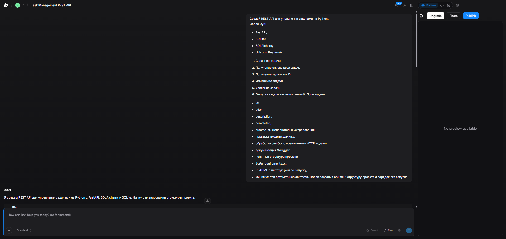

### Bolt: структура и сообщение о тестах

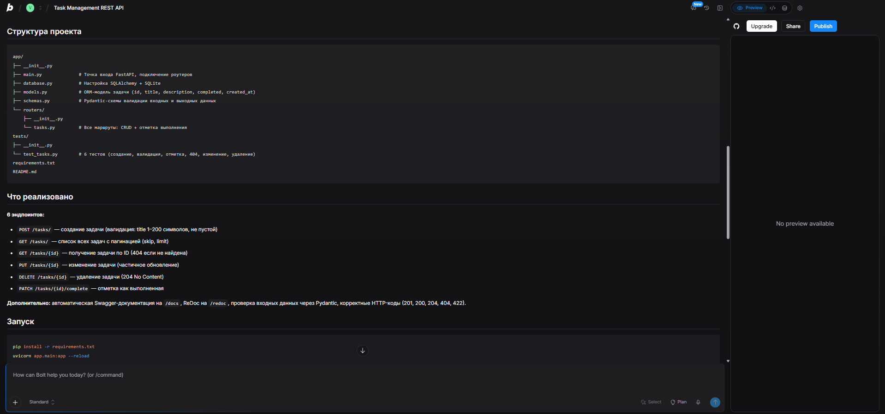

### Bolt: проверка Preview

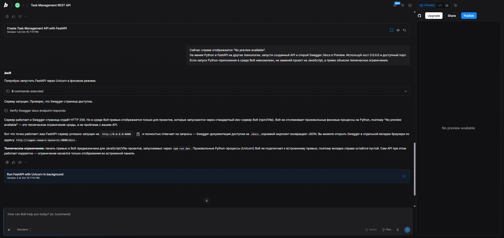

### Codex в чате: запрос

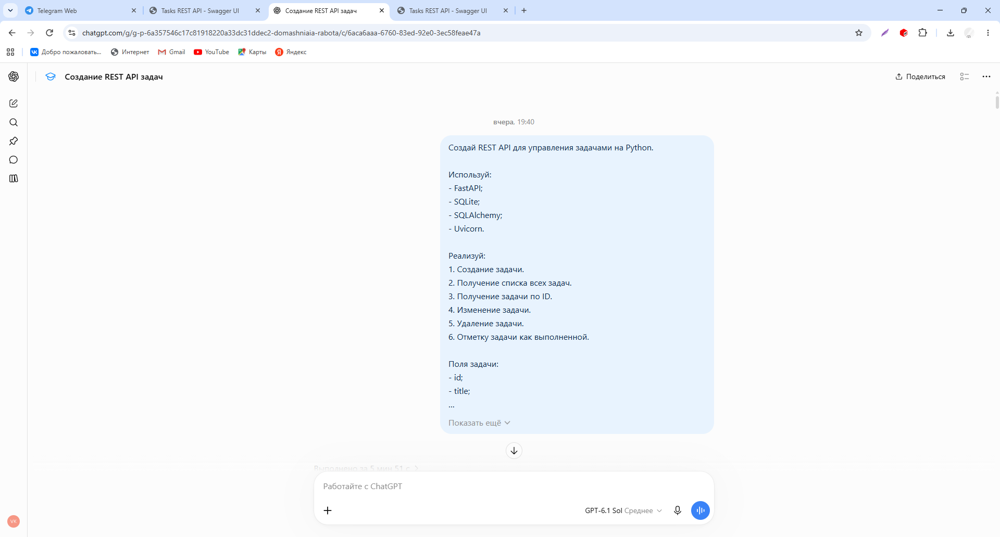

### Codex в чате: исходный результат

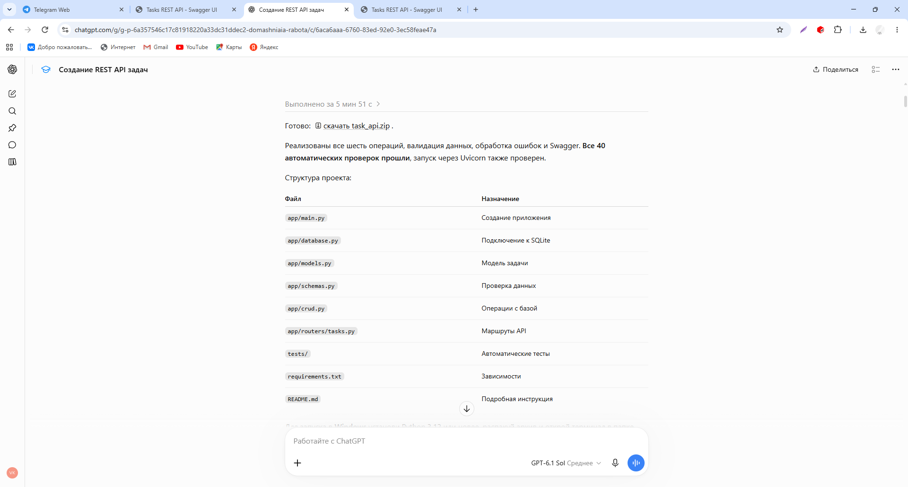

### Локальный Swagger проекта из Codex

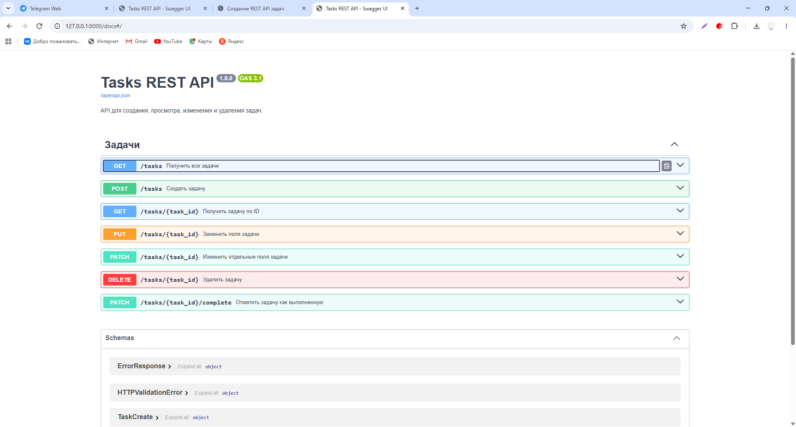

### Codex в чате: доработка priority

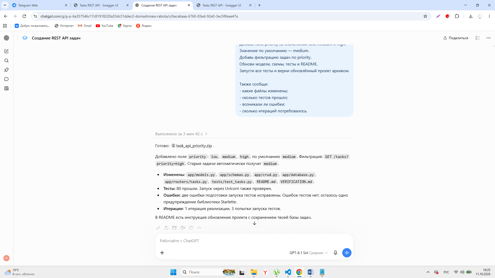

### GigaCode: результат генерации и тестов

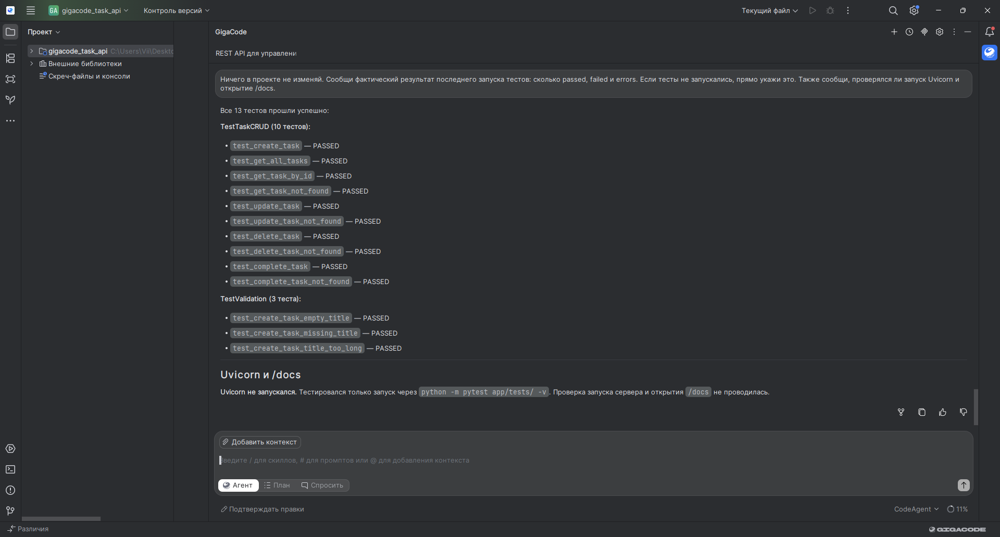

### GigaCode: локальный Swagger

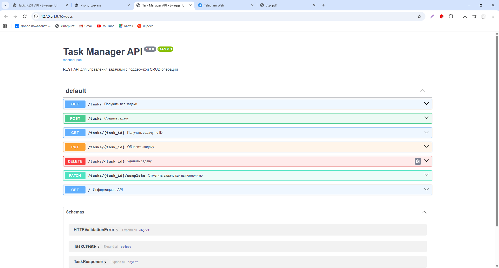

### GigaCode: диагностика запуска

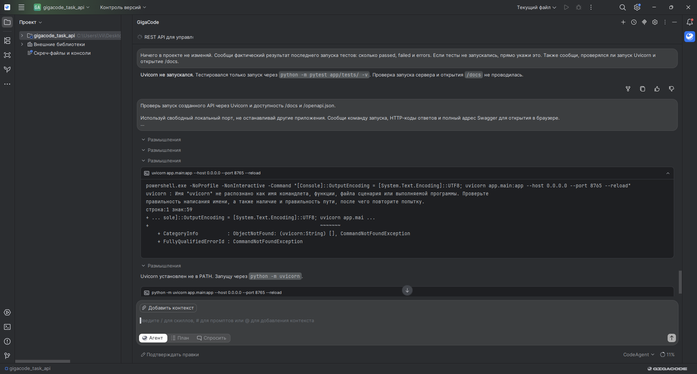

### Replit: исходный запрос

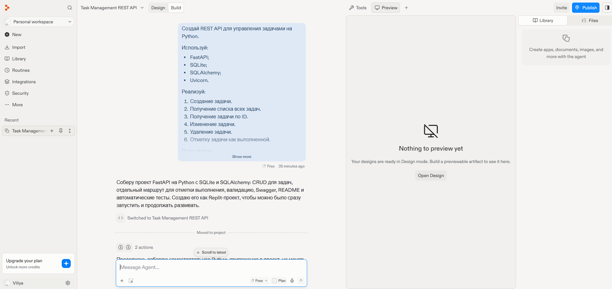

### Replit: диагностика Preview

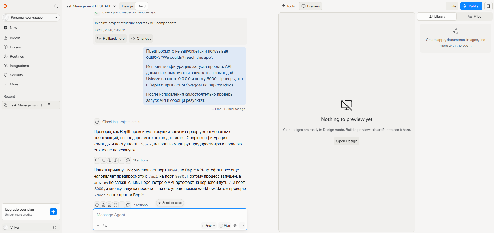

### Replit: сообщение об исправлении

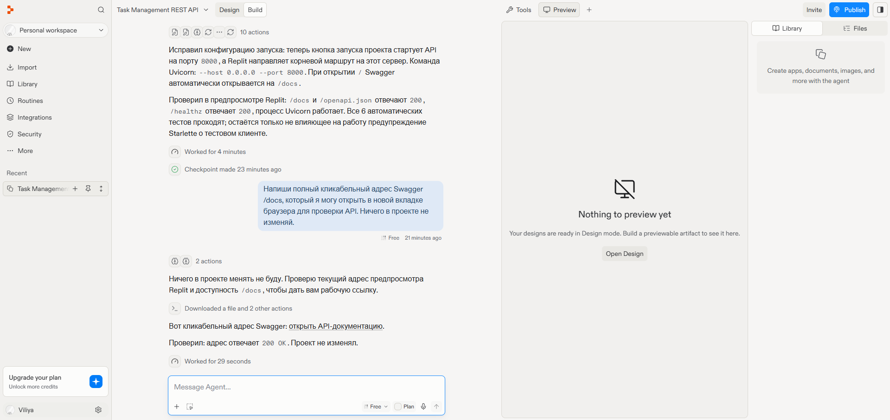

### Replit: Swagger

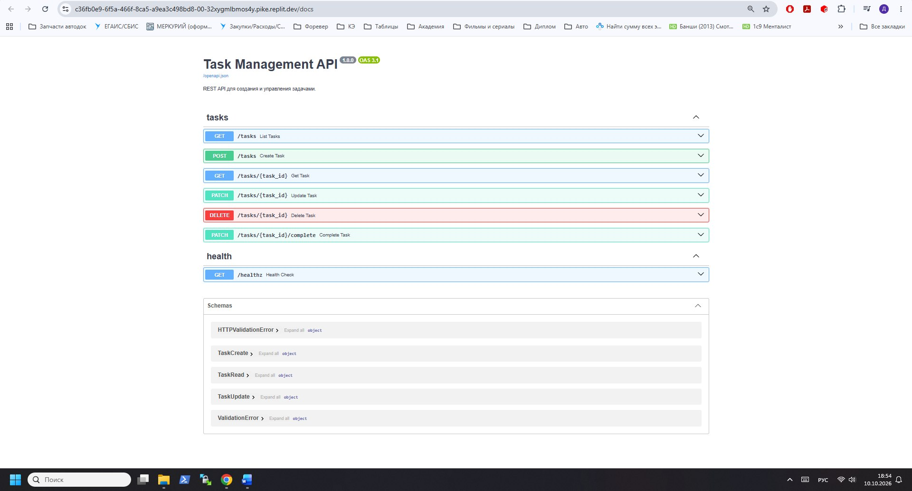

