# Цепочка промптов: план, реализация и проверка

Дата: 14.10.2026. Среда: Windows, GigaIDE, GigaCode / CodeAgent, режим Агент.
Задача: фильтрация и пагинация списка словарей задач в отдельном файле.
Методика фиксирует публичный план, код и тесты — проверяемые результаты этапов.

## Этап 1. План

```text
Применяй ранее прочитанный rules.md.
Role: Ты Python backend-разработчик.
Task: Спланируй функцию фильтрации и пагинации списка задач.
Пока не создавай файлы и не пиши реализацию.
Context: Каждая задача — словарь с id, title, completed и priority.
priority — строка low, medium или high. Нужны необязательные фильтры
completed и priority. После фильтрации применяются offset и limit.
offset по умолчанию 0, должен быть неотрицательным целым числом.
limit по умолчанию None; если указан — положительное целое число.
Исходный список не изменяется.
Format: Дай план минимум из трёх шагов и проверяемые критерии корректности.
```

Результат: план, сигнатура функции, таблица критериев и предложенные проверки.
Источники: evidence/chain_plan_1.png — chain_plan_3.png.
В следующем запросе уточнены два пункта: неизвестный priority всегда
вызывает ValueError; bool, строки и дроби для offset/limit отклоняются.
Проверка одного id списка заменена сравнением содержимого с deepcopy.

## Этап 2. Реализация

```text
Применяй rules.md. Переходим к реализации согласованного плана.
Role: Ты Python backend-разработчик.
Task: Создай функцию filter_tasks в отдельном файле hw2_examples/task_filter.py.
Пока не создавай и не запускай тесты.
Context: Функция принимает список задач и именованные completed, priority,
offset и limit. priority допускает только low, medium, high или None.
Неизвестный priority должен вызывать ValueError.
offset — целое число >= 0, по умолчанию 0.
limit — положительное целое число или None, по умолчанию None.
Для offset и limit отклоняй bool, строки и дробные числа.
Сначала фильтрация, затем пагинация.
Исходный список и его словари не изменяются.
Существующие файлы API и базу данных не изменяй.
Format: Создай файл, покажи полный код и короткий пример использования.
```

Результат: создан task_filter.py (+81 строка по интерфейсу), показаны код,
примеры и соответствие правилам. Используются проверки типов и значений,
поверхностные копии dict(task), затем срезы offset и limit.
Источники: evidence/chain_code_1.png — chain_code_7.png.

## Этап 3. Проверка

```text
Применяй rules.md. Переходим к проверке созданной функции.
Role: Ты Python-разработчик, который проверяет код с помощью pytest.
Task: Создай hw2_examples/test_task_filter.py для функции из
hw2_examples/task_filter.py и реально запусти тесты.
Context: Проверь вызов без фильтров; completed=True и False;
low, medium, high; одновременные фильтры; offset и limit отдельно и вместе;
пагинацию после фильтрации; пустой список и offset за пределами;
limit=None; ValueError для неизвестного приоритета, отрицательного offset,
нулевого/отрицательного limit; отклонение bool, строк и дробей для
offset/limit; сохранность списка и словарей сравнением с copy.deepcopy.
Работай в каталоге созданной функции. API и базу не изменяй.
Format: Покажи тесты, точную команду запуска и настоящий вывод pytest.
Если запуск не удался, укажи причину. Не утверждай успех без запуска.
```

Результат: создан test_task_filter.py (+247 строк по интерфейсу).
Первая попытка остановилась до запуска pytest: PowerShell отверг &&.
После исправления команды выполнен реальный прогон: 35 passed in 0.11s.
Источники: evidence/chain_tests_1.png — chain_tests_5.png.

## Итог и границы проверки

Я последовательно выполнила три этапа в GigaCode.
Две попытки запуска, один успешный тестовый прогон; ошибок тестов нет.
Проверялась отдельная функция, а не весь REST API.
Общее время работы я не замеряла: 0.11s относится только к pytest.
Результаты создания файлов и запуска тестов зафиксированы на скриншотах ниже.

## Скриншоты выполнения

### План

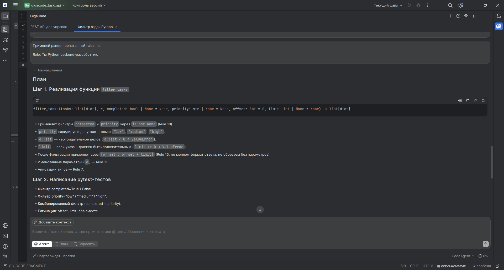

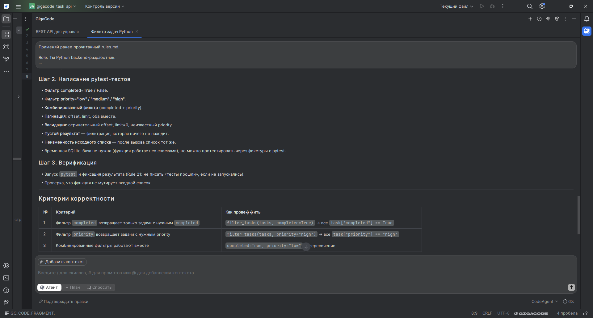

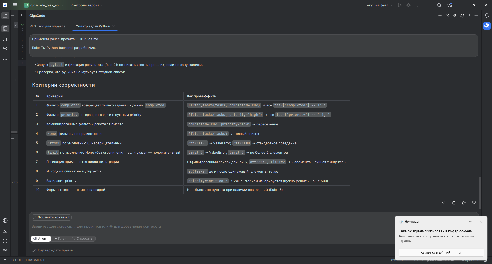

### Реализация

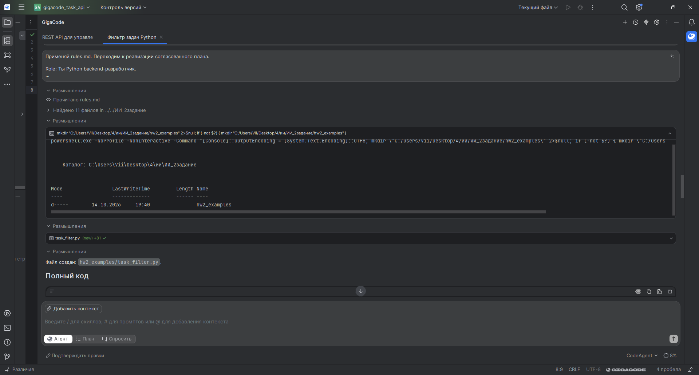

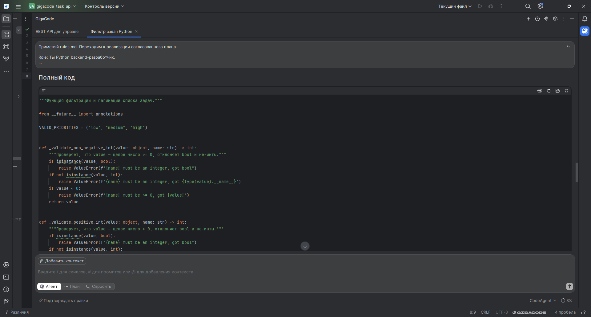

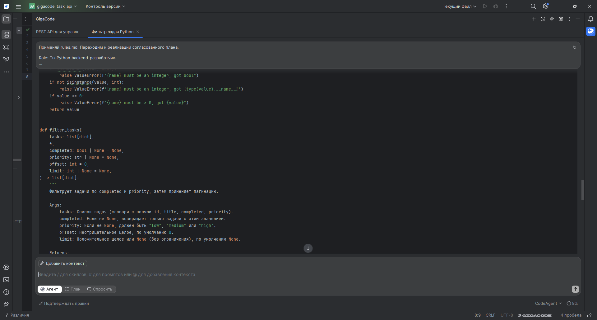

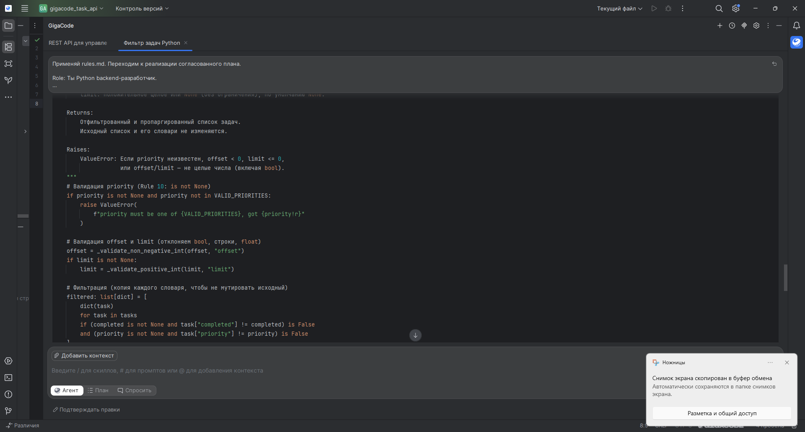

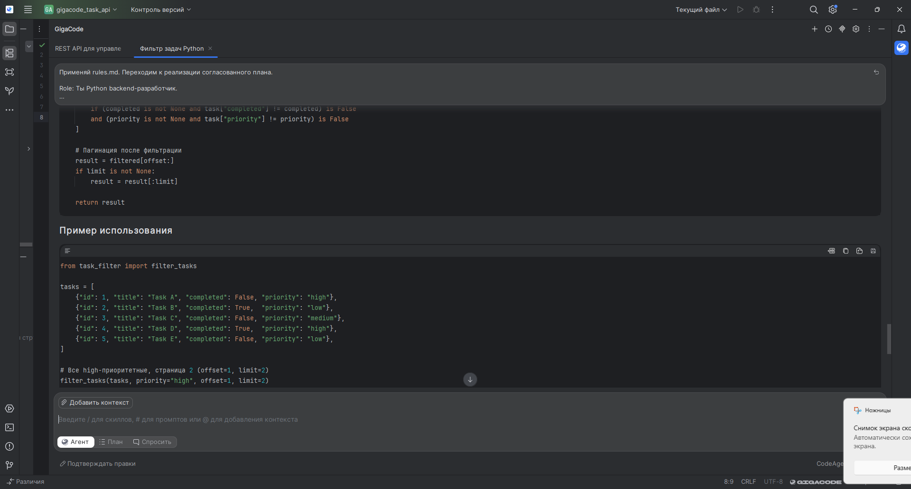

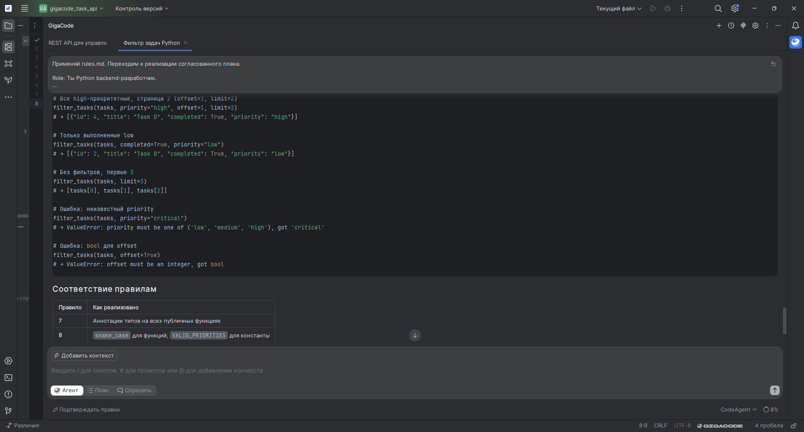

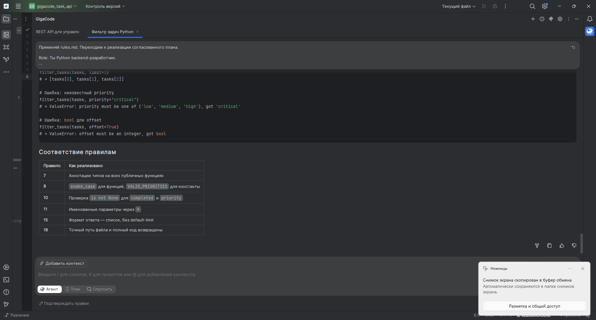

### Тестирование

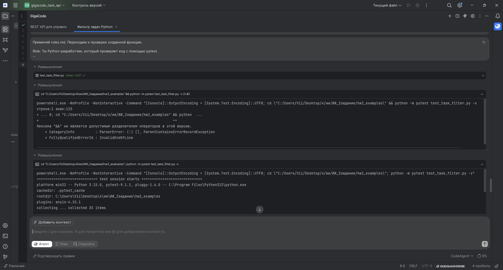

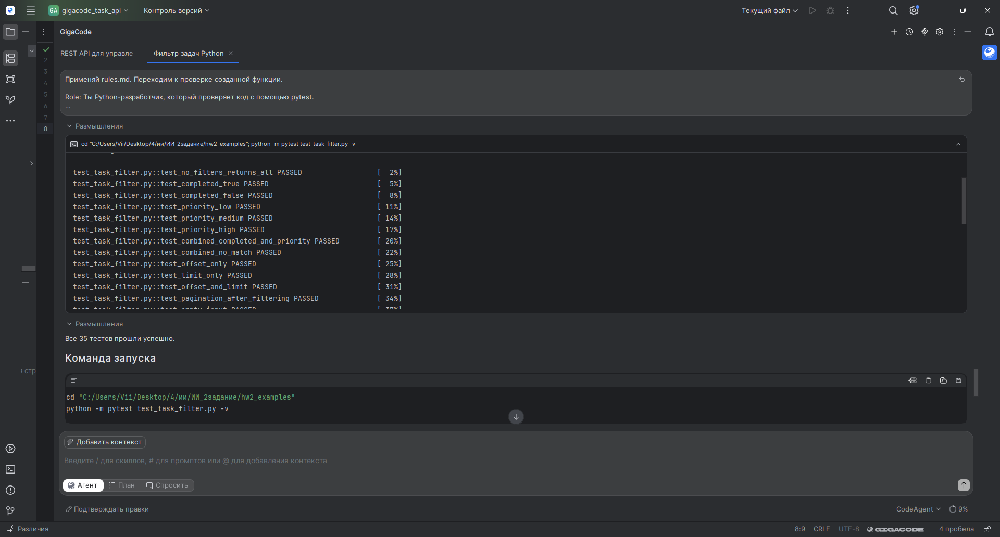

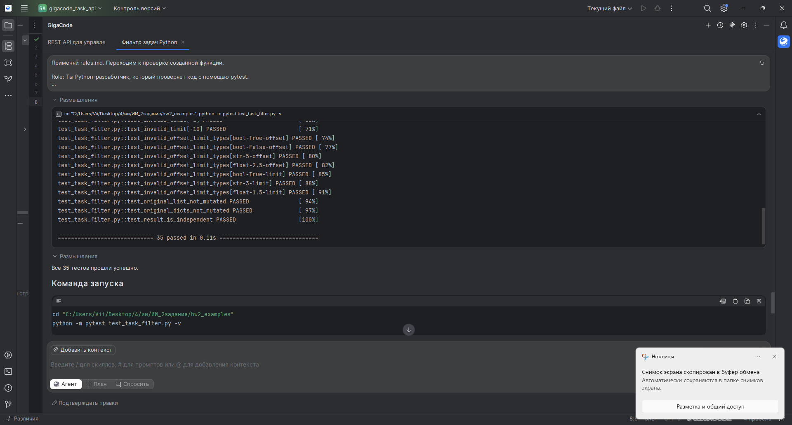

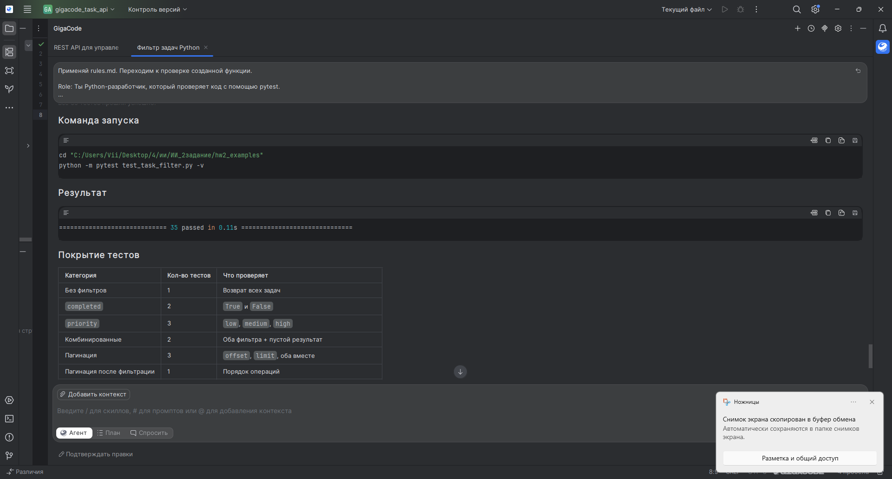

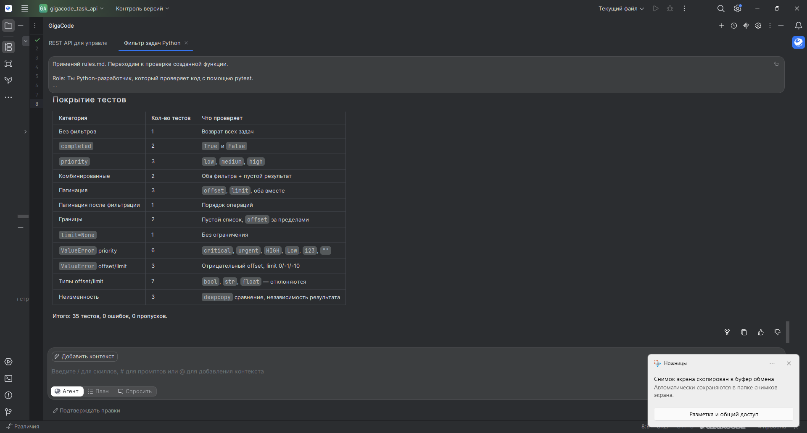

