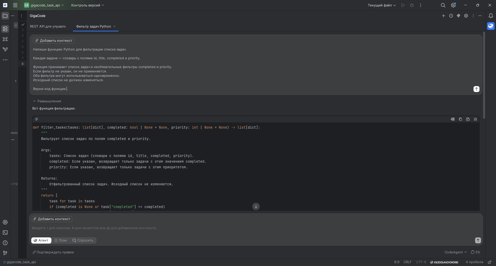
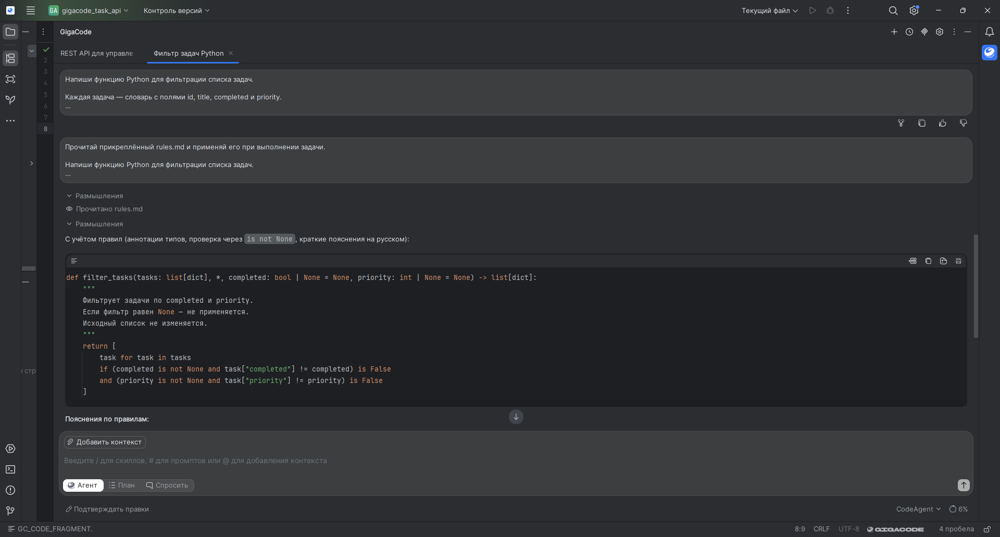
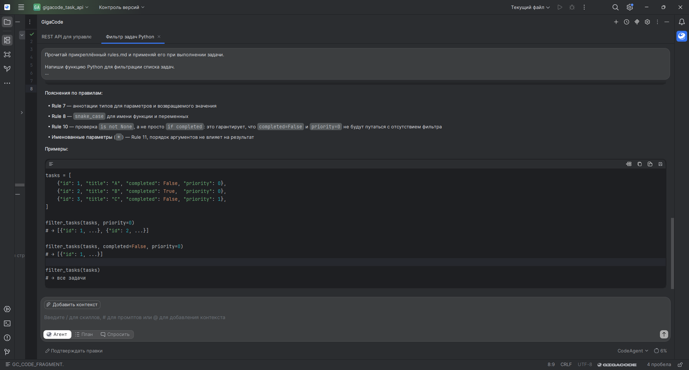

# Тестирование системы правил

## Условия сравнения

Я отправила GigaCode одну задачу без файла правил, затем прикрепила `rules.md`
и повторила задачу с инструкцией прочитать и применять файл. Оба запроса
выполнены в одном чате, поэтому второй ответ имел доступ к первому.
Дата выполнения: 14.10.2026. Среда: GigaIDE, GigaCode / CodeAgent, режим «Агент».

## Запрос без правил

```text
Напиши функцию Python для фильтрации списка задач.

Каждая задача — словарь с полями id, title, completed и priority.

Функция принимает список задач и необязательные фильтры completed и priority.
Если фильтр не указан, он не применяется.
Оба фильтра могут использоваться одновременно.
Исходный список не должен изменяться.

Верни код функции.
```

## Исходный код ДО применения правил

Ниже сохранён код функции из ответа агента без редактирования.

```python
def filter_tasks(tasks: list[dict], completed: bool | None = None, priority: int | None = None) -> list[dict]:
    """
    Фильтрует список задач по полям completed и priority.

    Args:
        tasks: Список задач (словари с полями id, title, completed, priority).
        completed: Если указан, возвращает только задачи с этим значением completed.
        priority: Если указан, возвращает только задачи с этим приоритетом.

    Returns:
        Отфильтрованный список задач. Исходный список не изменяется.
    """
    return [
        task for task in tasks
        if (completed is None or task["completed"] == completed)
        and (priority is None or task["priority"] == priority)
    ]
```



## Запрос с правилами

После прикрепления `rules.md` я добавила перед тем же запросом:

```text
Прочитай прикреплённый rules.md и применяй его при выполнении задачи.
```

## Исходный код ПОСЛЕ применения правил

Ниже сохранён код функции из второго ответа без редактирования.

```python
def filter_tasks(tasks: list[dict], *, completed: bool | None = None, priority: int | None = None) -> list[dict]:
    """
    Фильтрует задачи по completed и priority.
    Если фильтр равен None — не применяется.
    Исходный список не изменяется.
    """
    return [
        task for task in tasks
        if (completed is not None and task["completed"] != completed) is False
        and (priority is not None and task["priority"] != priority) is False
    ]
```





## Сопоставление

| Критерий | Без правил | С правилами |
|---|---|---|
| Аннотации типов | Есть | Есть |
| Одновременное применение двух фильтров | Предусмотрено | Предусмотрено |
| Различение None, False и 0 | Предусмотрено | Предусмотрено |
| Передача фильтров | Допускаются позиционные аргументы | Только по имени благодаря `*` |
| Условие фильтрации | Прямая проверка отсутствия фильтра или совпадения | Более сложное условие через `is False` |
| Пояснение соответствия правилам | Нет | Агент ссылается на правила |

В этой небольшой задаче тип `priority` не был задан: агент выбрал `int`.
В последующей цепочке строковые приоритеты заданы отдельно.

## Вывод

После подключения правил улучшилась определённость интерфейса функции:
параметры фильтра стали обязательными именованными аргументами благодаря `*`.
Это соответствует правилу 11 и помогает избежать путаницы между параметрами.
Агент также объяснил, каким правилам соответствует решение, поэтому результат
проще сопоставить с требованиями.

При этом аннотации типов и обработка `None`, `False` и `0` были уже в первом
ответе. Условие фильтрации после правил стало сложнее для чтения, поэтому
я не делаю вывод о превосходстве второго варианта по всем критериям.
Сравнение показывает конкретное улучшение интерфейса; выполнение обоих
запросов в одном чате ограничивает независимость сравнения.

## Отдельная проверка функции из трёхэтапной цепочки

Для функции фильтрации с пагинацией агент создал тесты и выполнил команду
из каталога `hw2_examples`:

```powershell
python -m pytest test_task_filter.py -v
```

Итог реального запуска: **35 passed in 0.11s**.
Первая попытка с `&&` остановилась из-за синтаксиса PowerShell до запуска
тестов; после исправления команды тесты прошли. Эти 35 тестов относятся
к расширенной функции из `prompt_methodology.md`.


