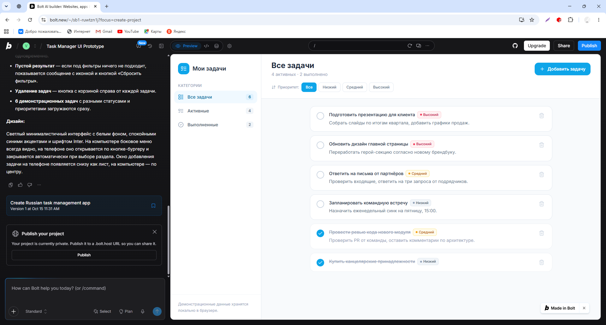
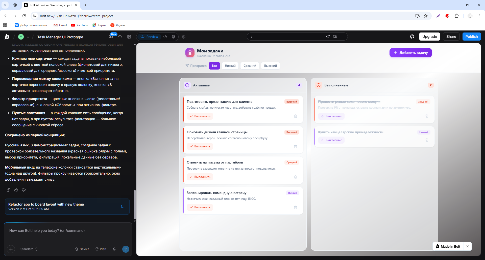
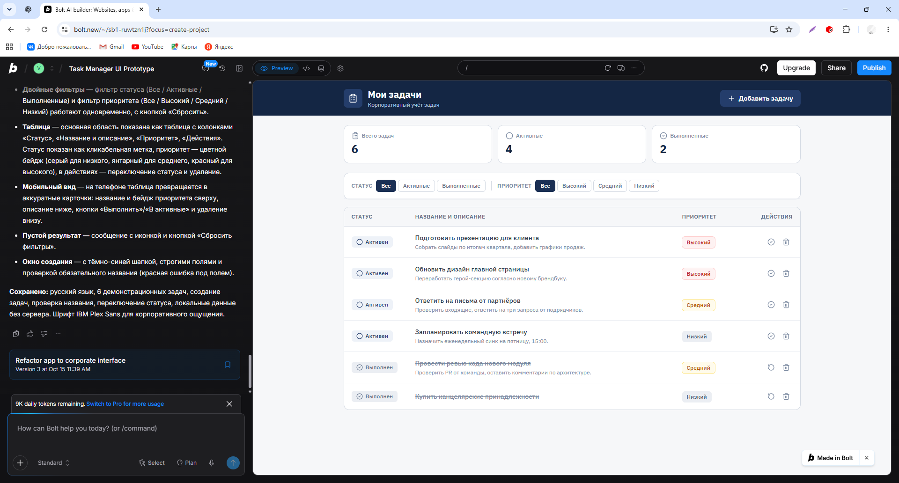

# Сравнение UI-концепций

Все три концепции получены в одном проекте Bolt последовательными
Text-to-UI запросами 15.10.2026. Сохранены снимки версий 1, 2 и 3.
Изображения подтверждают реальные результаты генерации, а не только описание.

| Концепция | Стиль и компоновка | Преимущества | Недостатки |
|---|---|---|---|
| 1. Светлый список | Белый фон, голубые акценты, меню слева, крупные карточки в одной колонке | Простая навигация по статусам; подробное описание задачи хорошо читается | Меню занимает ширину; карточки требуют вертикальной прокрутки |
| 2. Яркая доска | Фиолетовые и коралловые акценты, верхняя панель, колонки «Активные»/«Выполненные» | Распределение по статусам заметно сразу; явные кнопки переноса | При большом числе задач колонки становятся длинными; требуется больше места |
| 3. Корпоративная таблица | Тёмно-синяя шапка, общие счётчики, панель двух фильтров, строки таблицы | Компактное сравнение задач; понятные подписи полей; два фильтра видны вместе | Иконкам действий нужны доступные названия и подсказки; на узком экране нужна перестройка |

## Выбранная основа ТЗ: концепция 3

Для личного списка с приоритетами важны быстрое сравнение строк и заметные
фильтры. Третья концепция показывает статус, название, описание и приоритет
в одинаковых колонках и оставляет место для действий. Её ограничения учтены
в ТЗ: названия для иконок, управление клавиатурой и мобильные карточки.
Корпоративный стиль не означает наличие команд, прав доступа или аккаунтов.

Третья концепция принята как основа этого ТЗ. На ней также проведены
проверки создания задачи, фильтрации и смены статуса; снимки находятся
в `../evidence/`. Эти проверки помогают уточнить требования к взаимодействию.

## Изображения

Изображения представлены в исходном виде. Мобильная адаптация заявлена в
запросах Bolt
