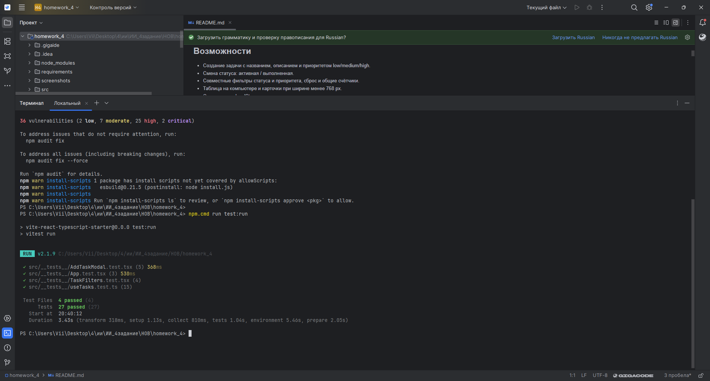
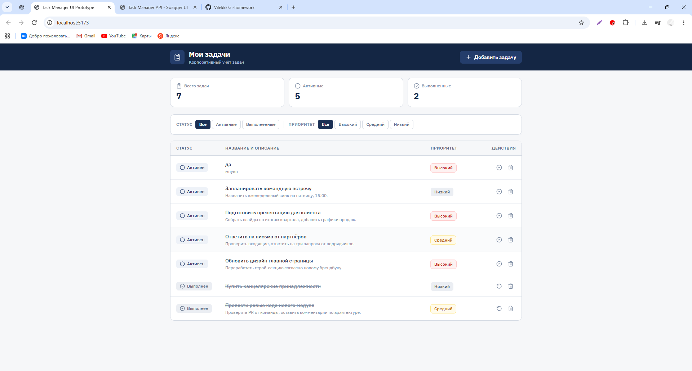
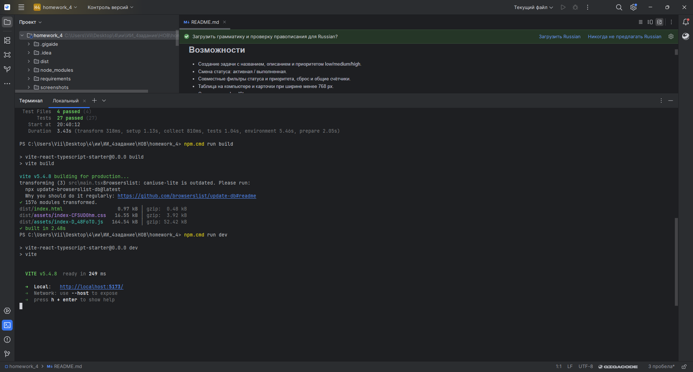

# Финальная проверка исходников ДЗ 4

Дата: 15.10.2026. Проверка выполнена с ChatGPT после получения `project.zip`.
Окружение контрольной проверки: Linux, Node.js 24.19.0, npm 11.9.0.
Это отдельная проверка; исходная ручная практика выполнялась на Windows.

## Результаты

| Проверка | Результат |
|---|---|
| Установка из lockfile | `npm ci --ignore-scripts --no-audit --no-fund` завершилась успешно |
| Проверка типов | `npm run typecheck` — без ошибок |
| ESLint | `npm run lint` — без ошибок |
| Production-сборка | Контрольная сборка успешна; на Windows `npm.cmd run build` — 1576 модулей, built in 2.48s |
| Проверки функций и компонентов | Все четыре файла вывели успешные результаты: 15 + 4 + 5 + 3 = 27 сценариев |
| Завершение процесса Vitest в контрольной среде | Процесс завис после результатов файлов; остановлен вручную. Успешный код завершения полного прогона здесь не получен |
| Исходный запуск на Windows | До финальных исправлений: 13 passed, подтверждено скриншотом |
| Проверка окончательной версии на Windows | `npm.cmd run test:run` завершилась: 4 файла, 27 passed, Duration 3.43s; приглашение PowerShell вернулось |
| Мобильный вид | Исходная версия проверена в Chrome DevTools 360×800; новые изменения переноса текста проверены по коду, без нового браузерного снимка |

Логи контрольной среды: [типизация](verification_logs/typecheck.txt),
[линтинг](verification_logs/lint.txt), [сборка](verification_logs/build.txt),
[тестовые сценарии](verification_logs/tests.txt).

Сценарии покрывают создание, отклонение неверного ввода, смену статуса,
удаление, фильтры, восстановление после повторного монтирования,
пустое и повреждённое сохранение, ошибки хранилища и работу формы.
Вывод успешных результатов сценариев не приравнивается к успешному
завершению всей команды в этой контрольной среде.

## Особенности контрольного окружения

Нативный парсер Rollup в Linux-среде проверки завершался внутренней ошибкой.
Для контрольной сборки локально использован WebAssembly-парсер Rollup 4.24.0.
Диагностировалось также зависание закрытия окружения Vitest; проверка другой
версии jsdom не решила проблему, исходные package.json и lockfile восстановлены.
Служебные изменения установленных пакетов для диагностики в архив не включены.
Версии зависимостей сдаваемого проекта совпадают с присланным архивом.

Остаётся предупреждение Browserslist об устаревшей базе caniuse-lite.
Полный аудит зависимостей не выполнялся. Публичный деплой не выполнялся;
локальный запуск описан в README и допускается заданием.

## Соответствие восьми шагам задания

| Шаг | Материалы |
|---|---|
| 1. ТЗ, стек, UI-библиотека, минимум три функции | `requirements/`, README, отчёт |
| 2. Инициализация проекта и окружение | package.json, lockfile, конфигурации Vite/Tailwind/TypeScript; отчёт о переносе Bolt и запуске |
| 3. Базовая структура | `src/components`, `src/hooks`, `types.ts`, `demoData.ts`; роутер для одного экрана не требуется |
| 4. Компоненты и итерации с AI | src, промпты и результаты в отчёте; локальные данные, ошибки и уведомления |
| 5. Тестирование и отладка | `src/__tests__`, исходные скриншоты, контрольные логи; ограничение завершения нового прогона указано выше |
| 6. Адаптивность | Таблица/карточки, исходные desktop/mobile-снимки, исправление переноса текста |
| 7. Рефакторинг | useTasks, отдельные компоненты, useMemo; измеренное ускорение не заявляется |
| 8. Оформление | Код, README, package.json, тесты и Markdown-отчёт включены; загрузка в GitHub выполняется отдельно |

## Успешный финальный прогон на Windows

После установки зависимостей выполнена команда `npm.cmd run test:run`.
Vitest 2.1.9: **Test Files 4 passed (4), Tests 27 passed (27), Duration 3.43s**.
Процесс завершился и вернул приглашение PowerShell. Это подтверждает
полный успешный прогон окончательной версии на Windows, несмотря на
ограничение контрольной Linux-среды, описанное выше.



Установка через `npm.cmd ci` заняла 5 минут, добавлено 378 пакетов.
В текущем терминале предварительно установлен корректный ComSpec:
`$env:ComSpec = "$env:SystemRoot\System32\cmd.exe"`.
Вывод установки содержит 36 уязвимостей зависимостей: 2 low, 7 moderate,
25 high, 2 critical. Отдельное исправление и анализ этих предупреждений
не выполнялись. Блокировка postinstall esbuild не помешала данному запуску
тестов; сборка на Windows затем успешно завершилась.

## Команды для повторения проверки

В распакованной папке проекта выполнить:

```powershell
npm.cmd ci
npm.cmd run test:run
npm.cmd run typecheck
npm.cmd run lint
npm.cmd run build
npm.cmd run dev
```

На Windows итоговая сводка Vitest, успешная сборка и открытый интерфейс
подтверждены приведёнными скриншотами. Мобильная проверка исходной версии
зафиксирована в отчёте; отдельного снимка окончательной мобильной версии нет.
Для сдачи загрузить всю папку `homework_4` из подготовленного архива на GitHub
и передать ссылку. Созданные при установке `node_modules`, `dist` и локальные
настройки IDE в подготовленный архив не входят.

## Финальная сборка и запуск на Windows

`npm.cmd run build`: Vite 5.4.8, 1576 модулей, **built in 2.48s**,
приглашение PowerShell вернулось. Затем `npm.cmd run dev`: **ready in 249 ms**,
адрес http://localhost:5173/. Сохранено предупреждение Browserslist.
Окончательная версия открыта в Chrome по адресу localhost:5173: показаны
таблица, фильтры, кнопка добавления и счётчики 7/5/2.




