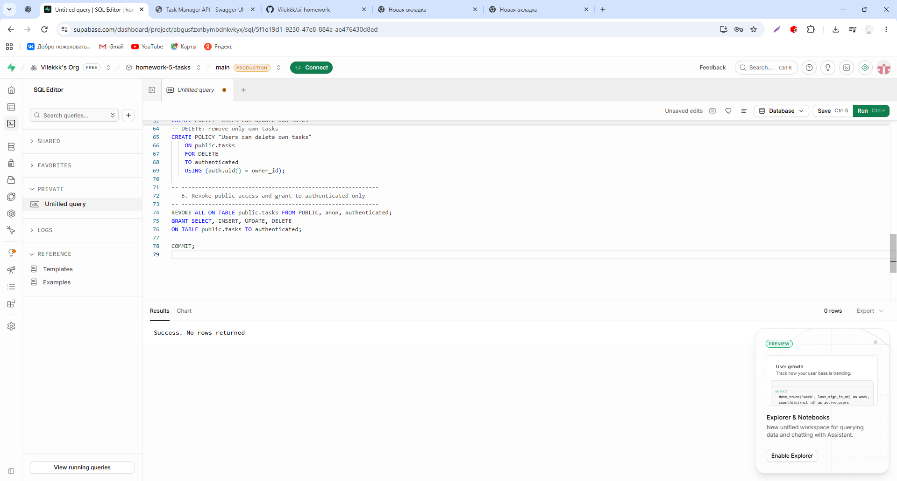
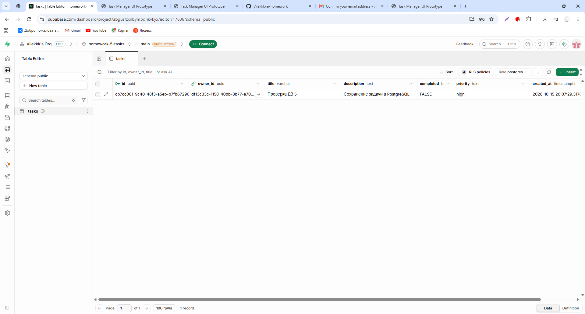
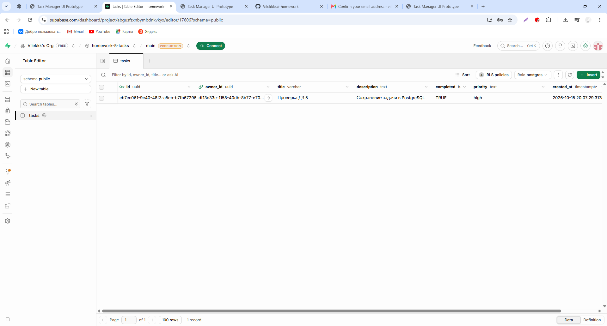
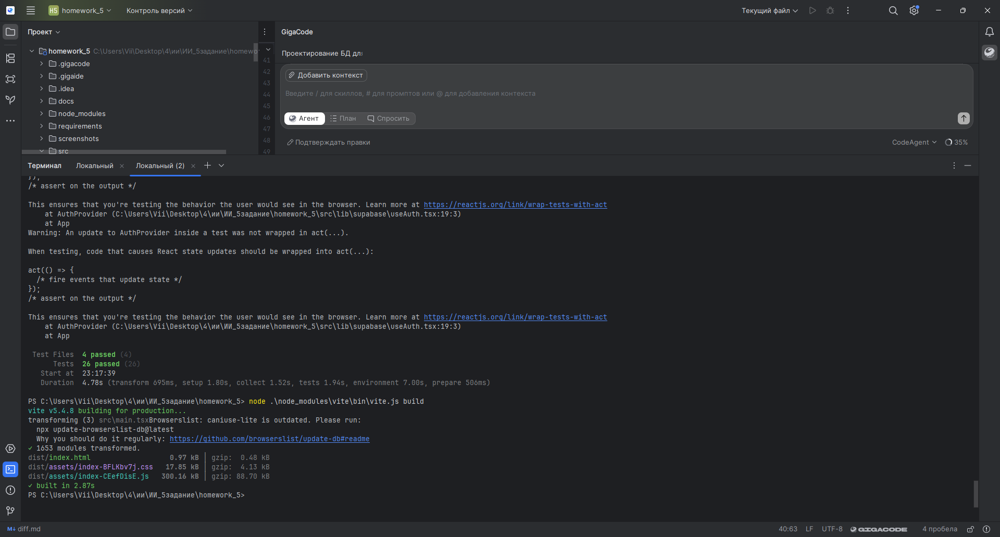
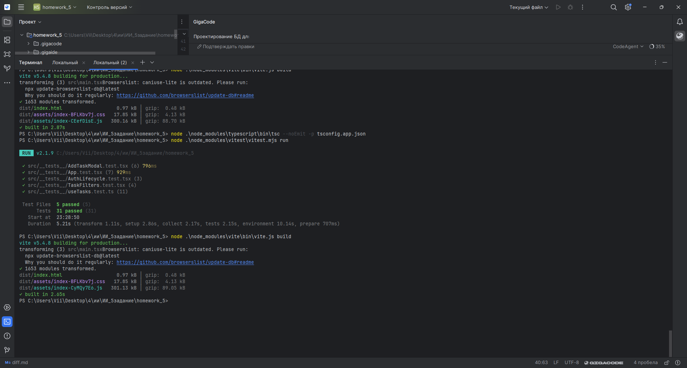
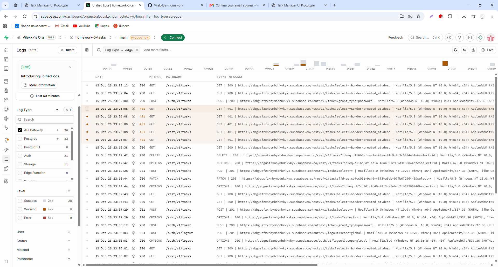

# Развёртывание Backend и интеграция с Frontend — ДЗ 5

Дата: 15.10.2026.

## Архитектура и выбор решения

Я выбрала вариант A из задания — Supabase. Для приложения задач нужны
PostgreSQL, регистрация и вход, четыре операции с задачами и разграничение
доступа. Supabase предоставляет эти возможности без отдельного VPS.
Docker и собственный HTTP-сервер для выбранного варианта не нужны.

Frontend React → типизированный Supabase SDK → Supabase Auth и REST API
PostgREST → PostgreSQL. Таблица `public.tasks` связана с `auth.users`
полем `owner_id`; одному пользователю соответствует множество задач.
Storage, Realtime и WebSocket-подписки в приложении не используются.

## Развёртывание

Я создала проект `homework-5-tasks` в Supabase и выполнила миграцию
`supabase/migrations/20261015000100_create_tasks.sql` через SQL Editor.
Результат выполнения — Success; таблица tasks появилась в Table Editor.
База размещена в Supabase, frontend запускался локально на Windows.
Повторить запуск можно по README; для нового проекта миграция выполняется
один раз. Уже применённую миграцию повторно запускать не следует:
создание политик не является идемпотентным.

Миграция задаёт UUID-ключи, FK на auth.users, семь полей,
ограничения непустого названия, длины описания и значений приоритета,
индекс owner_id, RLS и четыре политики владельца.
Точная схема приведена в SQL-файле и таблице README.

## Безопасность и CORS

Регистрация и вход используют email/password через Supabase Auth.
JWT-сессия хранится и обновляется SDK. Каждая задача создаётся с owner_id
из текущей сессии. Фактическое право чтения и изменения проверяет PostgreSQL
через RLS, а не только frontend-фильтр.

Миграция отзывает права PUBLIC/anon/authenticated и выдаёт authenticated
только SELECT, INSERT, UPDATE, DELETE. SELECT/DELETE используют USING;
INSERT использует WITH CHECK; UPDATE — оба условия `auth.uid() = owner_id`.

Браузер обращается к управляемому REST API Supabase. В проекте нет
собственного CORS-middleware. Реальные CRUD-запросы из localhost:5173
в облачный Supabase прошли; блокировка CORS в проверенном сценарии отсутствовала.
Site URL и redirect URL для писем задаются отдельно в Authentication →
URL Configuration; они не являются настройками CORS.

В `.env.local` находятся VITE_SUPABASE_URL и публичный
VITE_SUPABASE_PUBLISHABLE_KEY. VITE-переменные доступны браузеру,
поэтому туда нельзя помещать secret/service_role или пароль PostgreSQL.
.env.local исключён из подготовленного архива и Git.
Изоляция чтения проверена в реальной базе через имитацию двух JWT subject
и переключение роли authenticated. Все три проверки доступа прошли;
второй реальный аккаунт не создавался. Запись от имени другого пользователя
отдельно не проверялась.
Просмотр Table Editor под ролью postgres не доказывает работу RLS.

## API endpoints

Базовый адрес: `https://<project-ref>.supabase.co`.
Все операции задач требуют публичный apikey и JWT вошедшего пользователя.

| HTTP | Endpoint | Назначение | Функция |
|---|---|---|---|
| GET | /rest/v1/tasks?select=*&order=created_at.desc | Список доступных задач | fetchTasks |
| POST | /rest/v1/tasks | Создание | createTask |
| PATCH | /rest/v1/tasks?id=eq.<uuid> | Изменение completed | setTaskCompleted |
| DELETE | /rest/v1/tasks?id=eq.<uuid>&select=id | Удаление с возвратом id | deleteTask |
| POST | /auth/v1/signup | Регистрация | signUp |
| POST | /auth/v1/token?grant_type=password | Вход | signIn |
| POST | /auth/v1/logout | Выход | signOut |

POST/PATCH используют возврат representation и single. DELETE тоже требует
одну возвращённую строку: отсутствие доступной строки не выдаётся за успех.
RLS ограничивает список текущим владельцем. Фильтры статуса и приоритета
применяются в интерфейсе к загруженным задачам.

### Примеры запросов

Это шаблоны для повторения, а не журналы реально выполненных curl-команд.
Переменные URL, PUBLIC_KEY, ACCESS_TOKEN, USER_ID, TASK_ID заполняются
локально. Не публиковать токены и Authorization-заголовки на скриншотах.

```bash
curl "$URL/rest/v1/tasks?select=*&order=created_at.desc" \
  -H "apikey: $PUBLIC_KEY" -H "Authorization: Bearer $ACCESS_TOKEN"

curl -X POST "$URL/rest/v1/tasks" \
  -H "apikey: $PUBLIC_KEY" -H "Authorization: Bearer $ACCESS_TOKEN" \
  -H 'Content-Type: application/json' -H 'Prefer: return=representation' \
  --data "{\"owner_id\":\"$USER_ID\",\"title\":\"Проверка\",\"priority\":\"high\"}"

curl -X PATCH "$URL/rest/v1/tasks?id=eq.$TASK_ID" \
  -H "apikey: $PUBLIC_KEY" -H "Authorization: Bearer $ACCESS_TOKEN" \
  -H 'Content-Type: application/json' -H 'Prefer: return=representation' \
  --data '{"completed":true}'

curl -X DELETE "$URL/rest/v1/tasks?id=eq.$TASK_ID&select=id" \
  -H "apikey: $PUBLIC_KEY" -H "Authorization: Bearer $ACCESS_TOKEN" \
  -H 'Prefer: return=representation'
```

В PowerShell при использовании этих шаблонов вызывать curl.exe и учитывать
правила экранирования PowerShell; для Windows-проверки проще использовать
приложение и вкладку Network DevTools.

## Реализация интеграции и ошибок

`client.ts` создаёт один клиент `createClient<Database>`.
`database.types.ts` содержит конкретные Row/Insert/Update и Relationships.
Глубокие импорты внутренних типов SDK и пересечение с GenericSchema удалены.
`adapter.ts` преобразует created_at в createdAt. `operations.ts` выполняет
CRUD и сообщает ошибки через SupabaseApiError; ошибки API пишутся в console.error.
Auth-операции также используют общий клиент.

AuthProvider восстанавливает сессию, слушает её изменения, отключает
подписку при размонтировании, обрабатывает ошибку конфигурации и получения
сессии. Ошибка ссылки подтверждения отображается сообщением.
useTasks не запрашивает задачи до входа, очищает данные при смене пользователя,
отбрасывает поздние ответы предыдущей сессии, отображает ошибки загрузки.
Ошибка добавления не закрывает форму. При ошибке выхода сообщение сохраняется
на экране; отклонённый Promise обработан.

Пустое название и превышение длины отклоняются в форме, ограничения повторены
в PostgreSQL. Ошибки сети и ответы API, в том числе 401/403/500, проходят
общий путь обработки ошибки; фактические HTTP-коды всех этих случаев
вручную ещё не подтверждены. Модульные тесты используют подмену API
и не заменяют реальную проверку прав и серверных логов.

## Процесс работы с AI

Я использовала GigaCode в GigaIDE для проектирования таблицы и связи,
генерации миграции, CRUD-слоя, авторизации, интеграции и тестов.
Схему скорректировала: сохранила completed boolean, добавила owner_id,
отказалась от лишней таблицы profiles. Миграцию применила сама в Supabase.

При запуске обнаружились неправильный ComSpec и блокировка npm.ps1.
После исправления ComSpec в текущем терминале использовала npm.cmd
и прямой запуск TypeScript/Vitest/Vite через Node.js.

Ошибки TypeScript в insert/update были связаны с описанием Database.
Промежуточное решение с внутренними Generic-типами SDK ослабляло проверку
названий таблиц. С ChatGPT проверила типы и заменила их конкретной схемой;
типизированный createClient<Database> сохранила.

Ручная проверка обнаружила белый экран при отсутствии настроек,
ошибку ссылки подтверждения и permission denied при первоначальной загрузке.
После настройки окружения и входа CRUD заработал. Контрольный разбор кода
выявил запрос до входа, несколько клиентов Auth и отсутствие unsubscribe;
эти участки исправлены. Причина первоначального permission denied
по серверным логам пока не установлена: ранний запрос был найден в коде,
но единственной доказанной причиной того ответа его считать нельзя.

## Фактические результаты

На Windows до контрольных правок: 26/26 тестов, 4 файла, 4.78s;
сборка Vite успешна за 2.87s. Были предупреждения act и Browserslist.

Я зарегистрировалась и вошла, создала «Проверка ДЗ 5» с высоким приоритетом,
проверила строку в PostgreSQL, завершила задачу и увидела completed=TRUE.
Затем создала «Проверка удаления», удалила с подтверждением и проверила,
что в таблице осталась одна запись. Скриншоты включены в screenshots/hw5.

После контрольных правок я повторила проверки на Windows: TypeScript
завершился без ошибок; Vitest — 31/31 тест, 5 файлов, 5.21s;
Vite — 1653 модуля, сборка за 2.65s. Процессы завершились и вернули
приглашение PowerShell. В выводе итогового тестирования предупреждений
act не видно; предупреждение Browserslist при сборке осталось.

Контрольный запуск ChatGPT в Linux также показал успешные тесты по файлам,
проверку типов и сборку; процесс Vitest в этой среде зависал при завершении.
Итоговый полный прогон подтверждён моим Windows-скриншотом.

## Логи и проверка доступа

Я открыла Supabase Logs → API Gateway и передала сводку AI для анализа.
В журнале видны POST tasks 201, GET/PATCH/DELETE tasks 200,
OPTIONS 200, успешный вход 200 и выход 204. Были также GET tasks 401.
После перезапуска исправленного приложения и повторного входа запрос
входа в 23:32:00 и два следующих GET в 23:32:04/12 вернули 200.
Предыдущие 401 остались в истории; их точная причина по сводке не установлена.
Подробный разбор — [docs/log_analysis.md](docs/log_analysis.md).

Для проверки доступа выполнила
[supabase/checks/check_read_access.sql](supabase/checks/check_read_access.sql).
Скрипт временно меняет роль и request.jwt.claim.sub, читает public.tasks,
а результаты складывает во временную таблицу. Таблицу задач не изменяет.

| SQL-проверка | Результат |
|---|---|
| Владелец видит свои задачи | true |
| Имитируемый другой пользователь не видит задачи | true |
| Анонимной роли запрещено чтение | true |

Эта проверка подтверждает разграничение чтения на реальной PostgreSQL.
Она не является входом вторым аккаунтом и не проверяет JWT-подпись Auth.
Политики записи проверены кодом миграции; создание/обновление/удаление
владельцем подтверждены практикой. Отдельного прогона чужих write-операций нет.

В выбранном окне Logs 5xx отсутствовали. Намеренно вызывать сбой сервера
500 не пыталась; ручной прогон каждого HTTP-кода 401/403/500 не заявляю.
Обработка ошибок API и сети предусмотрена в коде и проверяется модульно.

## Соответствие девяти шагам задания

| Шаг | Результат и материалы |
|---|---|
| 1. Проектирование БД | docs/database_design.md, миграция tasks → auth.users |
| 2. Выбор инфраструктуры | Supabase, обоснование выше; VPS не использовался |
| 3. Развёртывание | Облачный проект, SQL применён, RLS включён |
| 4. API | Автоматический REST, четыре CRUD-операции, успешные ответы в Logs |
| 5. Безопасность | Email/password Auth, четыре политики, проверка чтения, реальные .env исключены |
| 6. Интеграция | React, SDK, useAuth/useTasks, реальные данные вместо mock-хранилища |
| 7. Ошибки и логи | Сообщения UI, console.error, Supabase Logs, AI-разбор |
| 8. Тестирование и отладка | 31 тест, typecheck, build, CRUD вручную, SQL и логи |
| 9. Оформление | Этот MD, README, код, миграция, .env.example, скриншоты; загрузка на GitHub выполняется отдельно |

## Передача результата

Материалы следует загрузить в папку homework_5 репозитория
https://github.com/Vilekkk/ai-homework. Факт загрузки этой итоговой версии
в момент подготовки отчёта ещё не подтверждён.
Backend развёрнут в Supabase; запуск frontend локальный по README.
Публичный frontend-деплой не заявляется, задание допускает инструкции запуска.

## Подтверждения практической работы















