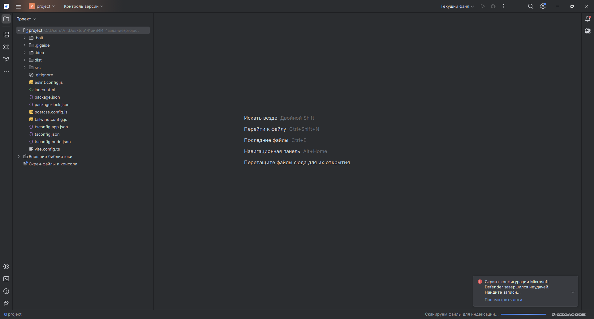
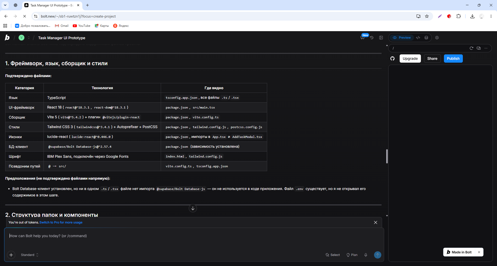
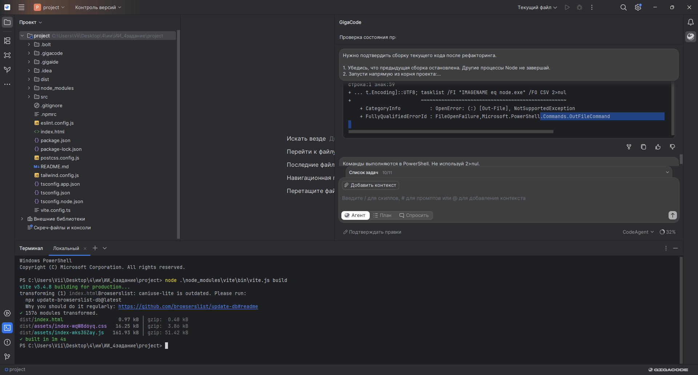
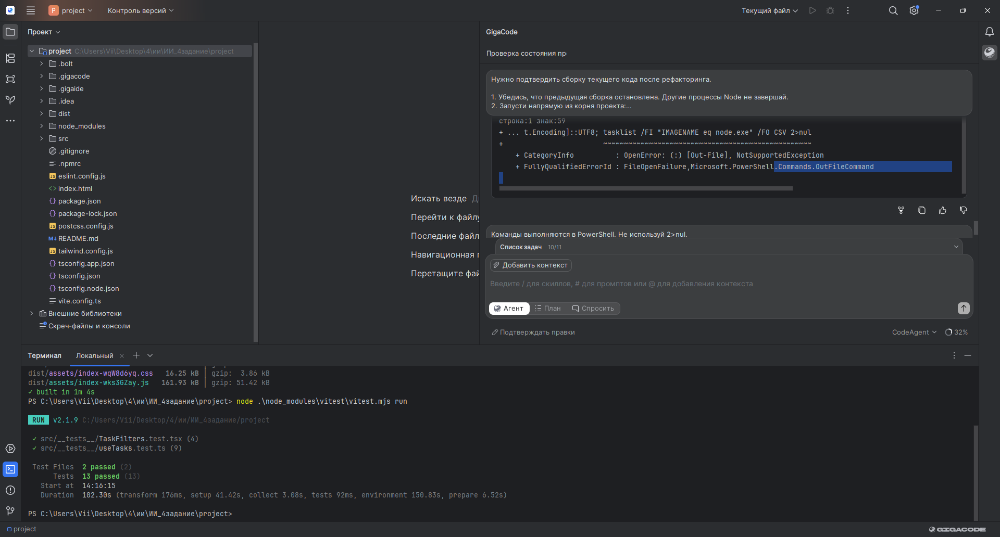
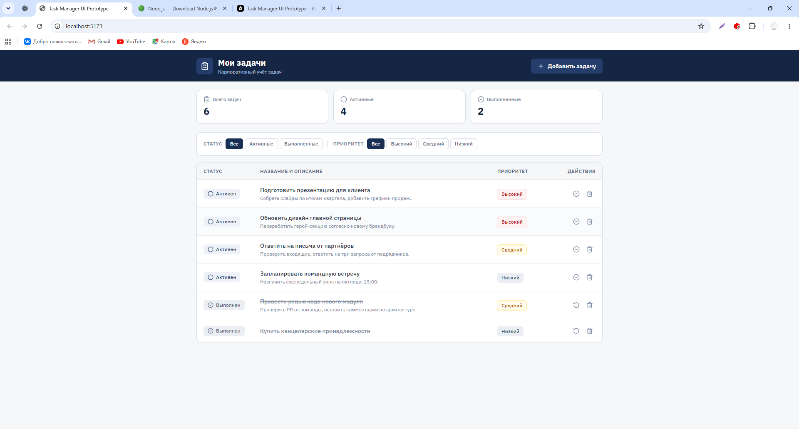
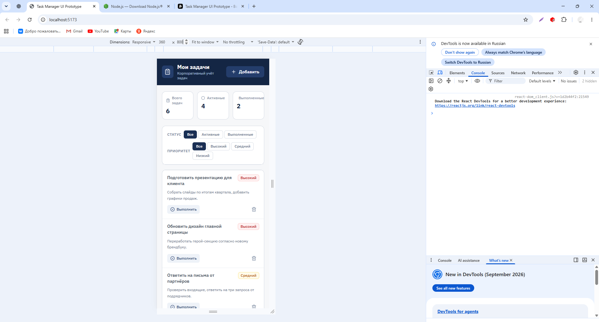
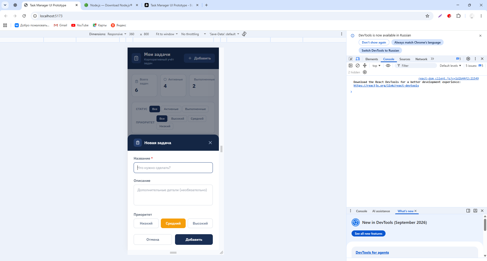

# Отчёт о разработке frontend-приложения «Мои задачи»

Домашнее задание № 4. Дата выполнения: 15 октября 2026 года.

## 1. Цель и требования

Я продолжила разработку приложения «Мои задачи» по техническому заданию из ДЗ 3.
В качестве основы выбрала корпоративный вариант: тёмно-синяя шапка, счётчики,
фильтры статуса и приоритета, таблица на компьютере и карточки на телефоне.

Основные функции: создание задачи с названием, описанием и приоритетом;
переключение выполнения; совместная фильтрация по статусу и приоритету.
Дополнительно в задачу доработки включила сохранение в localStorage,
валидацию формы, обработку пустой выдачи и структурирование компонентов.

## 2. Технологии и инструменты

Для генерации исходного интерфейса я использовала Bolt. После исчерпания
доступного лимита скачала проект и продолжила работу в GigaIDE с GigaCode,
в режиме «Агент», модель CodeAgent. Запуск и итоговые проверки выполнила
также вручную во встроенном терминале PowerShell.

Стек проекта: React 18, TypeScript, Vite 5, Tailwind CSS 3, lucide-react.
Тестирование: Vitest 2.1.9 и React Testing Library.
Локальное окружение: Windows, Node.js 24.22.0, npm 11.19.1, Google Chrome.
В выводе финальной сборки указан Vite 5.4.8.

## 3. Подготовка проекта

Сначала я поручила Bolt проанализировать существующие файлы без изменений.
Анализ показал, что основные функции уже реализованы, но автоматических
тестов и сохранения между перезагрузками нет, а значительная часть логики
сосредоточена в App.tsx.

Скачала исходники через Download, распаковала архив и открыла папку project
как отдельный проект в GigaIDE. Первоначальная проверка не находила node
и npm, поэтому я установила Node.js LTS и перезапустила IDE.

После установки Node запускался, но npm не мог корректно запускать дочернюю
оболочку: в ошибке ENOENT был указан несуществующий cmd.exe в каталоге Maven.
Для дальнейшей работы использовалась корректная оболочка только в текущем
процессе. Системный PATH и установку Maven я не изменяла.

Промежуточная установка зависимостей была выполнена с --ignore-scripts;
после настройки окружения агент сообщил об успешном npm ci. Итоговые
тесты и production-сборку я отдельно подтвердила прямыми командами Node.





## 4. Реализация и рефакторинг с AI

Я передала GigaCode задачу сохранить текущий дизайн и основные функции,
вынести работу с задачами в useTasks, разделить компоненты интерфейса,
добавить localStorage, валидацию и тесты. Запретила подключать сервер,
аккаунты и базу данных, менять системный PATH и обновлять весь стек.

В ходе доработки появились компоненты фильтров и элементов списка,
пользовательский хук useTasks и отдельные тестовые файлы. Это позволило
проверять работу с состоянием отдельно от отображения фильтров.
В package.json добавлены команды тестирования, обновлён README.
Наличие компонентов TaskItem и тестов useTasks/TaskFilters отражено в
истории изменений и фактическом выводе проверок.

Требования к форме я уточнила в запросе: trim названия, длина 1–200 символов,
описание до 2000 символов, средний приоритет по умолчанию. Для localStorage
потребовала загрузку существующих задач без повторного добавления демоданных
и предупреждение при ошибке записи. Полная ручная проверка всех граничных
значений формы и ошибок хранилища в эту сессию не входила.

Рефакторинг был направлен на читаемость и разделение ответственности.
Измерение прироста производительности я не проводила.

## 5. Ошибки и способы решения

| Проблема                                                | Решение и результат                                                                  |
| ------------------------------------------------------- | ------------------------------------------------------------------------------------ |
| Node и npm не найдены                                   | Установила Node.js и перезапустила GigaIDE                                           |
| npm выдавал ENOENT при запуске cmd.exe                  | Использовала корректный COMSPEC для текущего процесса; системные настройки не меняла |
| Команда с 2>nul завершилась ошибкой PowerShell          | Заменили диагностику на Get-Process node -ErrorAction SilentlyContinue               |
| Конфликт редактора и диска для package.json             | Загрузила актуальные изменения с диска                                               |
| Линтинг обнаружил ошибку в диагностическом check-npm.js | Временные диагностические файлы удалены, проверка повторена                          |
| При доработке возникли ещё 3 ошибки линтинга            | Агент исправил замечания и повторно выполнил ESLint                                  |
| Сборка через агент долго не возвращала результат        | Остановила ожидание и запустила Vite напрямую во встроенном терминале                |

По скриншотам и логам я с помощью AI различала ошибки приложения, оболочки
и вспомогательных файлов. Подтверждённый итог сборки получила только после
возврата приглашения PowerShell; успешную старую сборку не использовала
как доказательство работоспособности изменённого кода.

## 6. Автоматические проверки

Во встроенном терминале я выполнила:

```powershell
node .\node_modules\vite\bin\vite.js build
node .\node_modules\vitest\vitest.mjs run
```

Результат финальной сборки: Vite 5.4.8, 1576 обработанных модулей,
**built in 1m 4s**. Созданы dist/index.html и файлы CSS/JavaScript.
Результат тестирования подтверждён настоящим выводом Vitest:

```text
Test Files  2 passed (2)
Tests       13 passed (13)
Duration    102.30s
```

Пройдены 4 теста TaskFilters.test.tsx и 9 тестов useTasks.test.ts.
Таким образом, требование минимум трёх автоматических тестов выполнено.
Проверки TypeScript и ESLint после исправлений завершились без ошибок
по результатам команд в истории GigaCode.

Время 102.30 секунды относится к полному запуску Vitest, а не только к телам
тестов. Сборка заняла 1 минуту 4 секунды. Общее время разработки и число
внутренних попыток агента я отдельно не измеряла.

В сборке осталось предупреждение об устаревшей базе caniuse-lite. При
промежуточной установке npm также сообщил о 33 уязвимостях зависимостей;
отдельный аудит после доработки и устранение этих предупреждений не проводились.





## 7. Проверка интерфейса и адаптивности

Я запустила сервер командой:

```powershell
node .\node_modules\vite\bin\vite.js
```

Vite сообщил ready in 341 ms и адрес http://localhost:5173/.
Открыла приложение в Chrome. На компьютере отображаются таблица задач,
три общих счётчика, фильтры статуса и приоритета и кнопка создания.
Начальные данные: 6 задач, 4 активные, 2 выполненные.

Затем включила эмуляцию устройства в Chrome DevTools и установила размер
360×800. Таблица заменилась карточками, фильтры перенеслись на несколько
строк, кнопки создания и выполнения остались доступны. Проверила открытие
мобильной формы: поля названия, описания, приоритет и кнопки помещаются
в области устройства.

Создала на мобильном экране новую задачу «дз» с высоким приоритетом.
Она появилась первой в списке, общий счётчик увеличился до 7,
активных задач стало 5, выполненных осталось 2.

Сохранение состояния проверялось автоматическими тестами хука. Визуальная
серия фиксирует создание задачи, но не содержит отдельного подтверждения
момента перезагрузки страницы. Поэтому не рассматриваю эти снимки как
самостоятельное доказательство восстановления данных после reload.

На снимках консоли нет показанных красных ошибок JavaScript. В DevTools
виден индикатор Issues; его содержимое отдельно не исследовалось.
Подпись счётчика «Выполненные» при ширине 360 px близка к правому краю —
дополнительная полировка переноса текста остаётся рекомендацией.
Проверка выполнена в эмуляторе, а не на физическом телефоне.








## 8. Примеры применённых промптов

Ниже приведены сокращённые формулировки запросов, которые использовала
на разных этапах работы.

### Анализ исходного проекта

«Пока ничего не изменяй. Проанализируй существующий код: стек, папки,
команды package.json, наличие тестов и сохранения задач. Отделяй
подтверждённое файлами от предположений».

Результат: выявлены отсутствие тестов и сохранения, предложены направления
рефакторинга без смены исходного дизайна.

### Реализация и проверки — RTCF

Role: frontend-разработчик React и TypeScript.
Task: доработать «Мои задачи» для ДЗ 4.
Context: сохранить текущий дизайн, создание, переключение статуса и совместные
фильтры; добавить useTasks, localStorage, валидацию и совместимые инструменты
тестирования; не подключать сервер и не менять системные переменные.
Format: план, изменения, список файлов и фактические результаты тестов,
typecheck, lint и build.

Результат: доработанный проект и 13 прошедших автоматических тестов.

### Диагностика сборки

«Не начинай работу заново. Сообщи, какие проверки уже завершились и какая
команда осталась активной. Не запускай вторую сборку параллельно первой».

Результат: отделила уже завершённые проверки от неподтверждённой сборки,
после чего выполнила её вручную и получила конечный результат.

## 9. Локальный запуск и материалы для сдачи

Из корня проекта при доступном Node.js и рабочей оболочке:

```powershell
npm.cmd ci
npm.cmd run dev
npm.cmd run test:run
npm.cmd run typecheck
npm.cmd run lint
npm.cmd run build
```

В моём окружении для итоговой проверки использовала показанные выше прямые
команды Node. Сервер разработки работает, пока открыт соответствующий процесс
терминала. Публичный деплой не выполняла; в задании допускаются инструкции
локального запуска.

Код, package.json, lockfile, README, тесты, отчёт и скриншоты включены
в итоговый комплект `homework_4`. Для сдачи нужно загрузить эту папку
в GitHub-репозиторий и передать ссылку преподавателю.

## 10. Вывод

Я перенесла созданный с AI прототип в локальное окружение, доработала
структуру приложения с GigaCode, выполнила сборку и 13 тестов, проверила
компьютерный и мобильный интерфейсы. Наиболее полезными оказались конкретные
запросы с проверяемым результатом, анализ скриншотов и логов и ручной запуск
команд, когда агент не возвращал итог. Работоспособность подтверждена выводом
терминала и снимками локального приложения.

## 11. Финальная проверка перед размещением исходников

После первоначальной практики я передала архив исходников для дополнительной
проверки с ChatGPT. На этом этапе выполнялись анализ кода, исправления и
автоматические проверки в среде ChatGPT. Прежние 13 тестов и скриншоты выше
относятся к моему запуску на Windows; новые проверки описаны отдельно
в [verification.md](verification.md).

### Выявленные ошибки и исправления

| Проблема                                                                  | Исправление                                                                       |
| ------------------------------------------------------------------------- | --------------------------------------------------------------------------------- |
| Сохранённый пустой массив игнорировался, появлялись демозадачи            | Загрузка принимает `[]`; демоданные используются только при отсутствии сохранения |
| Повреждённые данные могли автоматически перезаписываться                  | Добавлена проверка структуры, предупреждение и запрет перезаписи до подтверждения |
| Ошибка сохранения была видна только в консоли                             | Предупреждение показано пользователю, текущие задачи остаются в памяти            |
| Слишком длинные название/описание отклонялись хуком, но форма закрывалась | Форма проверяет ограничения, показывает ошибку и сохраняет ввод                   |
| Подпись статистики и длинные слова могли выходить за узкую карточку       | Добавлены `min-w-0`, перенос слов и запрет сжатия иконок                          |
| Удаление выполнялось без подтверждения                                    | Добавлено подтверждение с названием задачи                                        |
| Пустой список описывался как неудачный фильтр                             | Разные сообщения для пустого списка и пустой выборки                              |
| Окно создания не поддерживало Escape и удержание фокуса                   | Добавлены семантика диалога, связи подписей с полями, Escape и управление фокусом |
| В `.npmrc` был абсолютный путь к оболочке Windows                         | Настройка удалена из переносимого комплекта                                       |

Добавлены автоматические сценарии для формы, восстановления пустого списка,
сохранности повреждённых данных, отказа хранилища и пользовательских действий
приложения. Очистка DOM после каждого теста задана явно.

### Связь с ТЗ и правилами

Требования из ДЗ 3 сохранены в `requirements/`. Для ДЗ 4 реализован локальный
frontend; сервер и аккаунты не подключались. Правила ДЗ 2 адаптированы к
React/TypeScript в [frontend_rules.md](../../frontend_rules.md). Исходные правила
про Python, SQLAlchemy и Swagger не применяются буквально к браузерному коду.
Адаптация включена при финальной доработке, без утверждения, что этот файл
существовал до первоначальной генерации Bolt.

Внутренняя модель frontend использует `createdAt` как число миллисекунд и
строковый `id`. В ТЗ поле времени описано как `created_at` ISO 8601 UTC;
при будущей интеграции с API нужен явный адаптер между этими форматами.
Сортировка согласована с ТЗ: активные перед выполненными, затем новые перед
старыми, `id` используется при равном времени.

### Состояния интерфейса

Успешное создание сопровождается сообщением. Неверный ввод показывает ошибку
и не закрывает форму. Пустой список отличается от отсутствия совпадений.
Сбой localStorage оставляет данные в памяти и показывает предупреждение.
Операции текущей версии синхронны и локальны; отдельный индикатор ожидания
сетевого ответа не требуется. Для будущего API состояния загрузки и доступа
описаны в ТЗ.

### Пример запроса при финальной проверке

Ниже краткая формулировка задачи проверки, а не дословная стенограмма:

```text
Role: frontend-разработчик React и TypeScript.
Task: проверь исходники по требованиям ДЗ 4 и исправь воспроизводимые ошибки.
Context: сохрани текущий дизайн и стек. Проверь пустое и повреждённое
сохранение, валидацию формы, мобильный перенос текста. Не добавляй сервер.
Format: исправленный код, регрессионные тесты, результаты typecheck, lint,
test и build, ограничения проверки и комплект для GitHub.
```

Подтверждения итоговой проверки и оговорки окружения приведены в
[verification.md](verification.md). Новые скриншоты окончательно изменённого
интерфейса в эту проверку не входят; исходная серия показывает предыдущую
версию, проверенную вручную на Windows.

## 12. Подтверждение окончательной версии на Windows

После получения исправленного комплекта я установила зависимости в новой
папке `homework_4`. Первая попытка `npm.cmd ci` не запускалась из-за пути
к командной оболочке. Указала системный cmd.exe через ComSpec только в
текущем процессе PowerShell и повторила установку. Добавлено 378 пакетов за 5 минут.

Затем выполнила `npm.cmd run test:run`. Получен полный успешный итог:

```text
Test Files  4 passed (4)
Tests       27 passed (27)
Duration    3.43s
```

Приглашение PowerShell вернулось. Проверены 15 сценариев useTasks,
4 сценария TaskFilters, 5 сценариев AddTaskModal и 3 сценария App.
Скриншот ниже относится к окончательной версии, а прежний снимок с
13 тестами — к предыдущему этапу разработки.


При установке npm сообщил о 36 уязвимостях зависимостей.
Их анализ и устранение отдельно не выполнялись.

## 13. Финальная сборка и запуск на Windows

Я выполнила `npm.cmd run build`: Vite обработал 1576 модулей,
сборка завершилась за 2.48 секунды. Затем запустила `npm.cmd run dev`:
сервер готов за 249 мс, адрес http://localhost:5173/.
Предупреждение Browserslist осталось, ошибок сборки нет.


## 14. Открытие окончательного приложения

После запуска dev-сервера я открыла http://localhost:5173/ в Chrome.
На экране отображаются таблица задач, общие счётчики, фильтры статуса и
приоритета, кнопка добавления. Показано 7 задач: 5 активных и 2 выполненные.
Это скриншот окончательной версии после исправлений.


Итог: окончательный проект запускается на Windows, production-сборка
завершается успешно, 27 автоматических тестов проходят. Исходники, инструкции,
тесты, отчёт и скриншоты включены в комплект. Размещение на GitHub —
следующее действие для сдачи; факт публикации этим отчётом не подтверждается.
