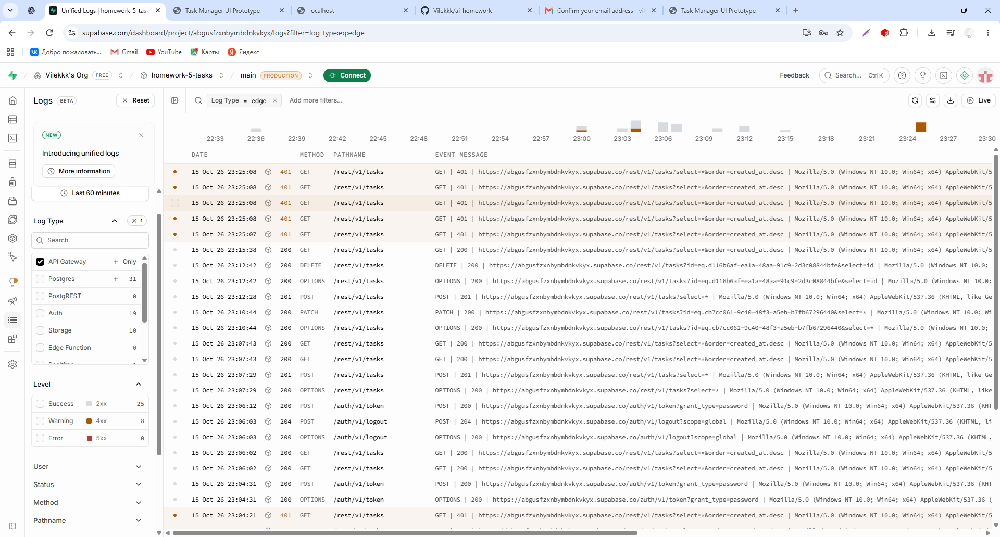

# Анализ Supabase Logs с AI

Дата: 15.10.2026. Источник: Supabase → Logs → API Gateway, последние 60 минут.

| Наблюдение в логе           | Интерпретация                                                                              |
| --------------------------- | ------------------------------------------------------------------------------------------ |
| POST /rest/v1/tasks — 201   | Запрос создания обработан успешно                                                          |
| GET /rest/v1/tasks — 200    | Запрос чтения обработан успешно                                                            |
| PATCH /rest/v1/tasks — 200  | Запрос обновления обработан успешно                                                        |
| DELETE /rest/v1/tasks — 200 | Запрос удаления обработан успешно                                                          |
| OPTIONS — 200               | Проверенные предварительные CORS-запросы успешны                                           |
| POST /auth/v1/token — 200   | Успешный запрос входа                                                                      |
| POST /auth/v1/logout — 204  | Успешный запрос выхода                                                                     |
| GET /rest/v1/tasks — 401    | Запрос отклонён на этапе аутентификации; точная причина из сводки неизвестна               |
| 5xx — 0                     | В выбранном окне серверных ошибок не видно; обработка искусственного 500 этим не проверена |

Я передала сводку логов ChatGPT для анализа. Ответы 401 могут быть связаны
с отсутствующим или недействительным JWT, но по скриншоту нельзя установить
конкретную причину. Рекомендация — перезапустить исправленную версию,
войти и проверить новый GET в логах. Отключение RLS и выдача анонимного доступа
для устранения 401 не требуются.

## Повторная проверка после входа

В 23:32:00 вход POST /auth/v1/token вернул 200. Следующие GET /rest/v1/tasks
в 23:32:04 и 23:32:12 вернули 200. В новых видимых запросах 401 нет;
старые отказы остались в истории. Это подтверждает успешный повторный сценарий,
но не устанавливает причину всех прежних 401.

