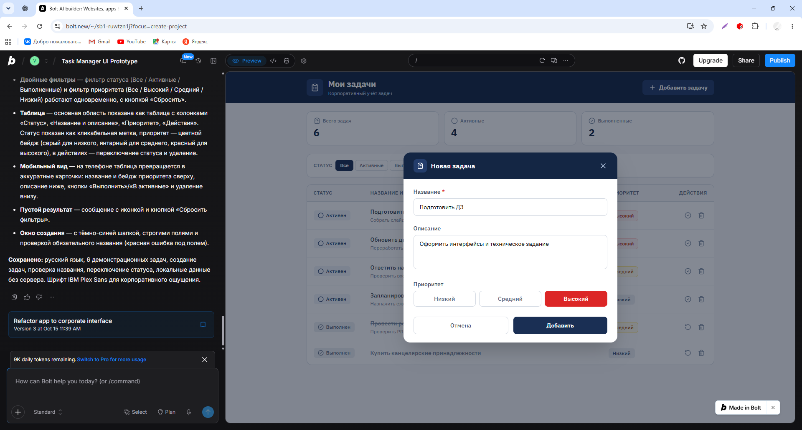
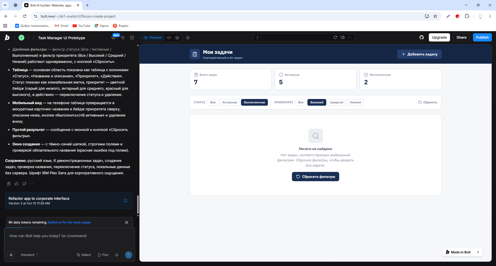
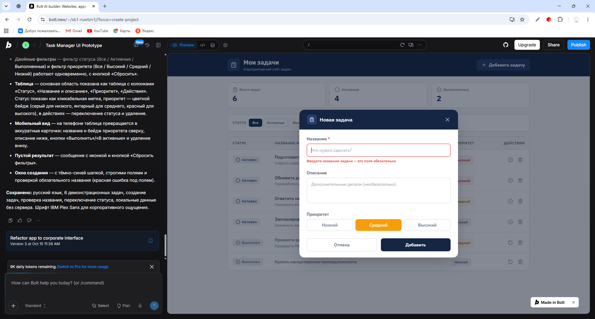
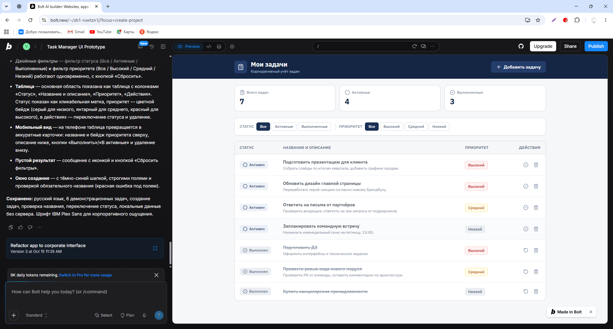
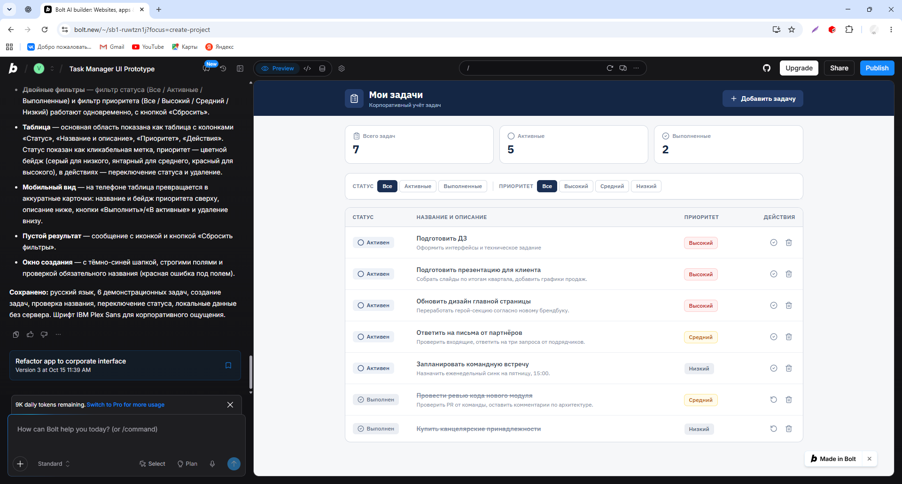

# Проверка интерактивного прототипа

Дата: 15.10.2026. Инструмент: Bolt, предпросмотр локального UI.
Результаты зафиксированы на скриншотах предпросмотра.

| Шаг | Действие и результат                                                      | Скриншот                                                                       |
| --- | ------------------------------------------------------------------------- | ------------------------------------------------------------------------------ |
| 1   | Созданы три различных UI-концепта                                         | ../ui_concepts/concept_1_minimal.png, concept_2_board.png, concept_3_table.png |
| 2   | Отправлено пустое название; поле выделено, показана ошибка, форма открыта | empty_title_validation.png                                                     |
| 3   | Заполнены название «Подготовить ДЗ», описание и высокий приоритет         | create_task_form.png                                                           |
| 4   | Задача появилась активной, общий счётчик 6→7, активные 4→5                | task_created.png                                                               |
| 5   | Активные AND Высокий: три строки, включая новую задачу                    | combined_filters.png                                                           |
| 6   | Выполненные AND Высокий: «Ничего не найдено» и кнопка сброса              | empty_filtered_result.png                                                      |
| 7   | После сброса и завершения задача выполнена; счётчики 7/4/3                | status_completed.png                                                           |

По последовательности снимков подтверждены успешный путь и два негативных
состояния: неверный ввод и пустая выдача. Сброс наблюдается вместе с последующим
завершением; отдельного промежуточного снимка сброса нет.
Не проверены: мобильный вид, сохранение после перезагрузки, клавиатура,
производительность, слишком длинные строки, удаление, повторное нажатие,
возврат выполненной задачи, сервер, сеть и авторизация.
Длительность работы не измерялась. 3 варианта UI получены тремя последовательными
запросами; это не утверждение об отсутствии внутренних попыток Bolt.

## Скриншоты

