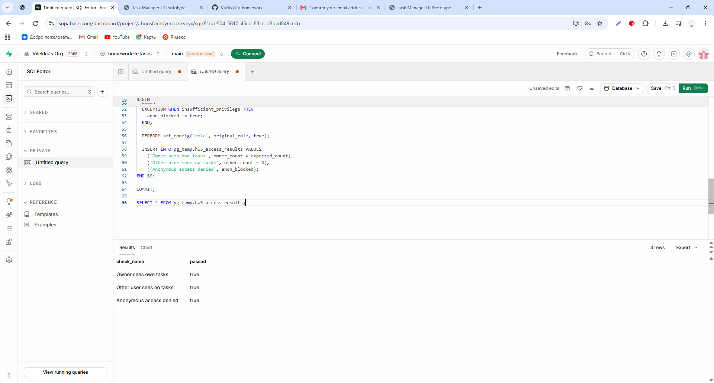

# Проверка ДЗ 5

| Проверка                                | Фактический результат                                                                                |
| --------------------------------------- | ---------------------------------------------------------------------------------------------------- |
| Supabase и миграция                     | Проект работает, SQL выполнен успешно, таблица из 7 полей и 4 политики видны                         |
| Регистрация и вход                      | Форма регистрации, письмо и дальнейший вход; первая ссылка возвращала otp_expired                    |
| Создание                                | Задача появилась в интерфейсе и public.tasks                                                         |
| Изменение                               | completed изменилось с FALSE на TRUE в PostgreSQL                                                    |
| Удаление                                | Вторая задача удалена из UI и таблицы, осталась одна запись                                          |
| Windows Vitest до контрольных правок    | 26/26, 4/4 файла, процесс завершился, 4.78s                                                          |
| Windows build до контрольных правок     | Успешно, 1653 модуля, 2.87s                                                                          |
| Проверка типов после контрольных правок | Успешно в Linux-среде ChatGPT                                                                        |
| Контрольная сборка                      | Успешно в Linux-среде ChatGPT                                                                        |
| Контрольные тесты                       | 31 PASS по файлам, завершение процесса ограничено зависанием Vitest в Linux                          |
| Повторная проверка Windows после правок | TypeScript без ошибок; Vitest 31/31, 5 файлов, 5.21s; build успешен, 2.65s                           |
| RLS: имитация другого subject / anon    | Все 3 SQL-проверки чтения true; второй Auth-аккаунт не создавался                                    |
| Supabase Logs и анализ AI               | CRUD: 201/200; старые GET 401; после повторного входа token и GET 200; docs/log_analysis.md          |
| Предел проверки ошибок                  | Ручной прогон каждого 401/403/500 не проводился; 401 есть в истории Logs, 500 намеренно не вызывался |
| GitHub с ДЗ 5                           | Загрузка этого результата ещё не подтверждена                                                        |

Исходный архив содержал node_modules и .env.local. В подготовленный исходный
архив они не включаются; локальные настройки пользователя сохраняются отдельно.
Предупреждения аудита зависимостей не исправлялись автоматически.
Результаты ДЗ 4 находятся отдельно в docs/homework_4_history.

